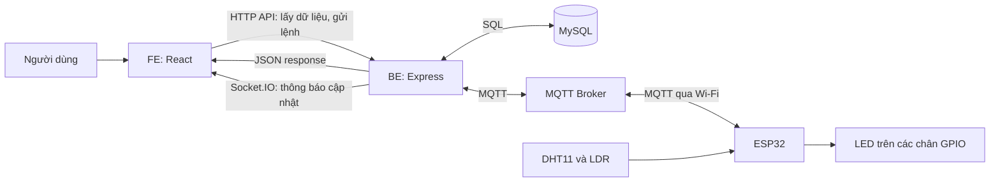
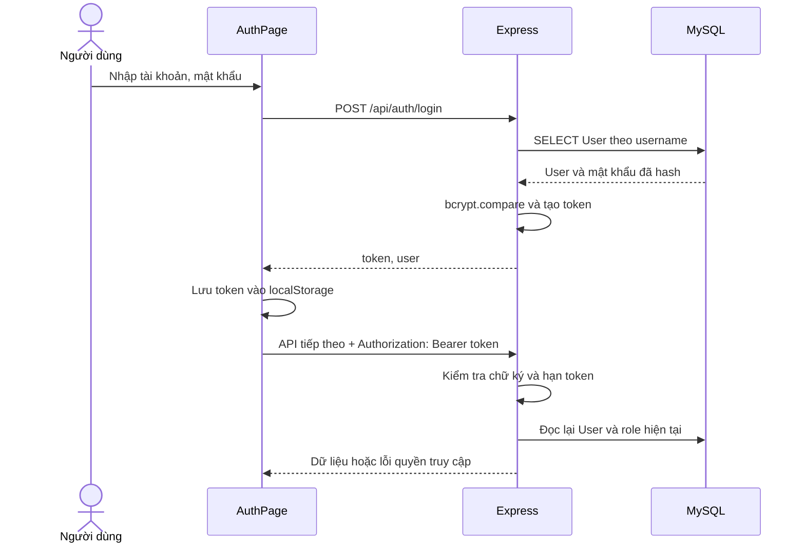
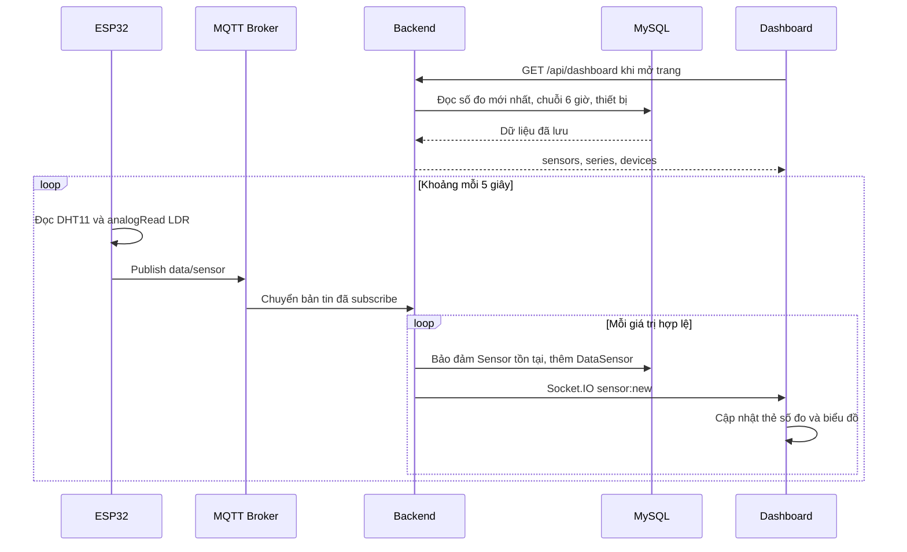
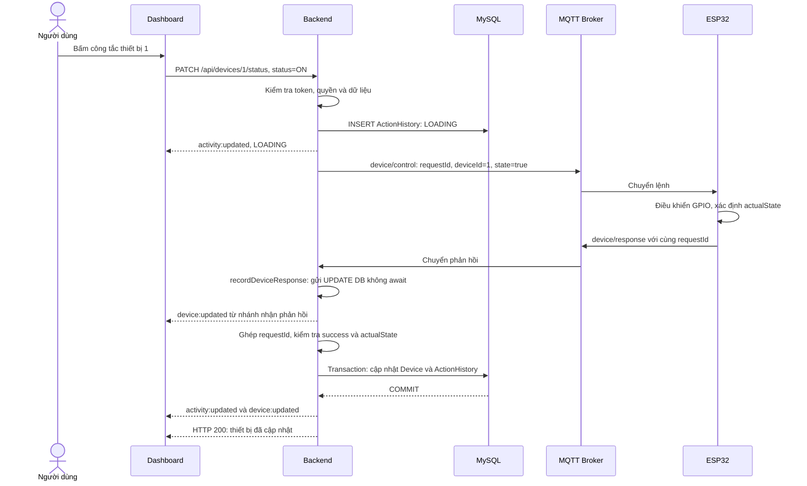
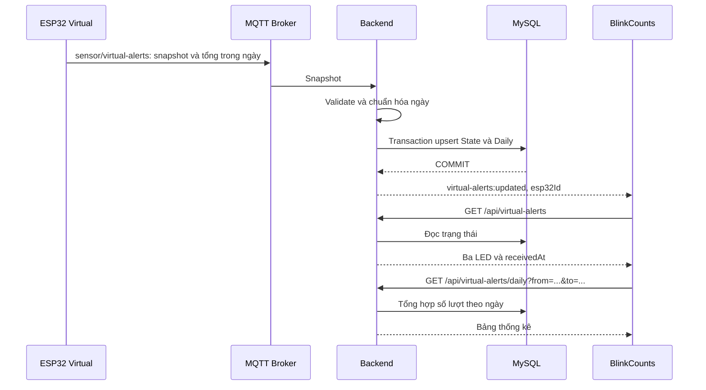
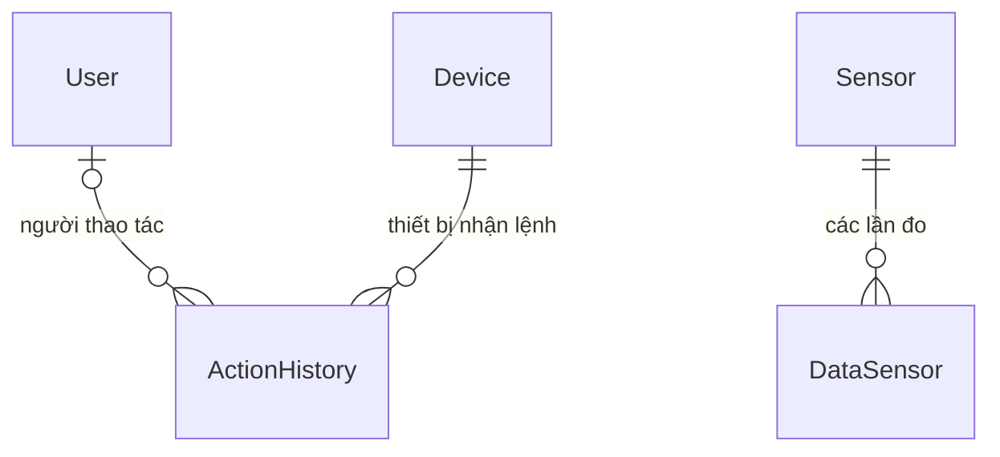
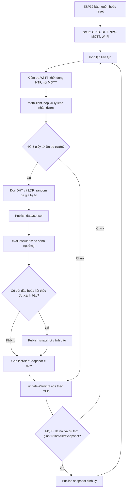

# Phân tích luồng FE – BE – Database – ESP32

Tài liệu dựa trên mã nguồn trong thư mục `G:\IoT`, đối chiếu ngày 11/11/2026. Các ví dụ giá trị và `requestId` bên dưới dùng để minh họa. Phân tích mô tả hành vi của code hiện tại; chưa xác nhận bằng thiết bị ESP32, MQTT Broker hoặc MySQL đang chạy.

Bổ sung: mục 19–20 giải thích trực tiếp sketch trong file `Pasted text.txt` bạn gửi. Sketch đó có một số khác biệt với `firmware/SmartRoomVirtual/SmartRoomVirtual.ino`; các mô tả mục 1–18 vẫn đối chiếu theo code trong repository.

Tra cứu nhanh:

| Muốn hiểu | Đọc phần |
| --- | --- |
| Kiến trúc, nơi tìm code, hai bản firmware, khởi động | Mục 1–4 bên dưới |
| Tài khoản, token, quyền truy cập | [5. Đăng ký và đăng nhập](#muc-5) |
| Số đo đi từ ESP32 lên màn hình như thế nào | [6. Luồng cảm biến thật](#muc-6) |
| Bấm công tắc thì hệ thống làm gì | [7. Luồng bật/tắt](#muc-7) |
| Cách đếm lượt cảnh báo ảo và lưu theo ngày | [8. Luồng cảnh báo ảo](#muc-8) |
| Tìm kiếm, lịch sử, lưu hồ sơ và đổi quyền | Mục 9–10 |
| Bảng DB, danh sách API, topic và sự kiện | [11. Database](#muc-11), [12. Các giao diện trao đổi](#muc-12) |
| Cú pháp React, JavaScript, SQL và ESP32 | [13. Giải thích code](#muc-13) |
| Cảnh báo và đếm nhịp của firmware SmartRoom | [14. Luồng cảnh báo thật](#muc-14) |
| Cấu hình, tìm lỗi, giới hạn, ví dụ ôn lại | [15. Cấu hình](#muc-15), [16. Lần theo lỗi](#muc-16), mục 17–18 |
| Đọc từng hàm và theo dõi dữ liệu trong đoạn code vừa gửi | [19. Giải thích sketch bạn gửi](#muc-19) |
| Hiểu hai khác biệt về ngày và lịch gửi snapshot | [20. Đối chiếu bản gửi với repository](#muc-20) |

## 1. Hiểu nhanh hệ thống

Hệ thống SMART ROOM có bốn phần chính và một MQTT Broker làm trung gian:

| Thành phần | Công nghệ trong dự án | Công việc |
| --- | --- | --- |
| FE — frontend | React, Vite, `socket.io-client` | Hiển thị số đo, biểu đồ, lịch sử; gửi yêu cầu bật/tắt thiết bị |
| BE — backend | Node.js, Express, `mqtt`, Socket.IO | Xác thực, xử lý API, nhận bản tin ESP32, truy vấn database |
| DB — database | MySQL, thư viện `mysql2/promise` | Lưu tài khoản, số đo, trạng thái thiết bị, lịch sử và thống kê cảnh báo |
| ESP32 | Arduino C++, WiFi, PubSubClient, DHT, ArduinoJson, Preferences | Đọc cảm biến, điều khiển GPIO, gửi/nhận MQTT, lưu bộ đếm tại thiết bị |
| MQTT Broker | Dịch vụ bên ngoài mã nguồn ứng dụng | Nhận bản tin từ bên gửi và chuyển đến các bên đăng ký đúng topic |



FE giao tiếp với BE, BE giao tiếp với DB và MQTT Broker, ESP32 giao tiếp với Broker. FE không truy vấn MySQL hoặc điều khiển GPIO trực tiếp. ESP32 cũng không gọi API Express trong các sketch hiện có.

Ba kênh trao đổi cần phân biệt:

- **HTTP API:** một bên gửi yêu cầu, bên kia trả lời. Ví dụ FE gọi `GET /api/dashboard`.
- **MQTT:** một bên publish bản tin vào topic, Broker chuyển bản tin cho các bên subscribe topic đó. Ví dụ ESP32 gửi số đo vào `data/sensor`.
- **Socket.IO:** BE chủ động gửi sự kiện cho trình duyệt đang kết nối. FE có thể dùng dữ liệu trong sự kiện hoặc gọi lại API tùy trang.

## 2. Bản đồ code và thứ tự nên đọc

| Khu vực | File | Ý nghĩa |
| --- | --- | --- |
| FE khởi động | [main.jsx](iot-fe/src/main.jsx), [App.jsx](iot-fe/src/App.jsx) | Gắn React vào HTML, kiểm tra đăng nhập, chọn trang theo URL hash |
| FE gọi BE | [client.js](iot-fe/src/api/client.js) | Tập trung `fetch`, token, query string và URL API/Socket.IO |
| FE tổng quan | [Dashboard.jsx](iot-fe/src/pages/Dashboard/Dashboard.jsx) | Tải số đo, cập nhật realtime, xử lý công tắc |
| FE dữ liệu | [SensorData.jsx](iot-fe/src/pages/SensorData/SensorData.jsx) | Tìm kiếm, sắp xếp, phân trang số đo |
| FE lịch sử | [ActivityHistory.jsx](iot-fe/src/pages/ActivityHistory/ActivityHistory.jsx) | Lọc lịch sử và tải lại khi có sự kiện |
| FE cảnh báo | [BlinkCounts.jsx](iot-fe/src/pages/BlinkCounts/BlinkCounts.jsx) | Hiển thị ba LED cảnh báo và số lượt theo ngày |
| FE tài khoản | [AuthPage.jsx](iot-fe/src/pages/Auth/AuthPage.jsx), [Profile.jsx](iot-fe/src/pages/Profile/Profile.jsx) | Đăng ký/đăng nhập, hồ sơ cục bộ, quản lý vai trò |
| BE khởi động | [server.js](iot-be/src/server.js), [app.js](iot-be/src/app.js) | Kết nối dịch vụ, mở server, đăng ký route và middleware |
| BE chức năng | [modules/](iot-be/src/modules/) | Mỗi file chứa API, xử lý nghiệp vụ và SQL của chức năng đó |
| BE nhận/gửi MQTT | [mqtt.client.js](iot-be/src/integrations/mqtt/mqtt.client.js), [mqtt.subscriber.js](iot-be/src/integrations/mqtt/mqtt.subscriber.js) | Kết nối Broker, theo dõi lệnh chờ phản hồi, phân loại bản tin |
| BE realtime | [socket.js](iot-be/src/integrations/websocket/socket.js), [events.js](iot-be/src/integrations/websocket/events.js) | Khởi tạo Socket.IO và đặt tên sự kiện |
| DB | [schema.sql](iot-be/database/schema.sql), [seed.sql](iot-be/database/seed.sql), [init.js](iot-be/database/init.js) | Tạo bảng, dữ liệu ban đầu và xử lý khởi tạo |
| Firmware cảnh báo ảo | [SmartRoomVirtual.ino](firmware/SmartRoomVirtual/SmartRoomVirtual.ino) | Cảm biến thật, LED thủ công và ba cảnh báo ảo riêng |
| Firmware cảnh báo thật | [SmartRoom.ino](firmware/SmartRoom/SmartRoom.ino) | Cảnh báo theo số đo thật và đếm từng nhịp LED |

Để hiểu nhanh, đọc theo thứ tự: `App.jsx` → `client.js` → `Dashboard.jsx` → `modules/devices.js` → `mqtt.client.js` → `mqttCallback()` trong firmware → `schema.sql`. Sau đó đọc luồng cảm biến và cảnh báo ảo.

## 3. Hai firmware có hành vi khác nhau

Hai file `.ino` là hai chương trình thay thế nhau khi nạp lên một ESP32. Có cả hai file trong repository không có nghĩa cả hai đang cùng chạy trên thiết bị.

| Nội dung | `SmartRoom.ino` | `SmartRoomVirtual.ino` |
| --- | --- | --- |
| Đọc DHT11/LDR thật | Có | Có |
| Gửi `data/sensor` | Có | Có, kèm đối tượng `virtualSensors` |
| Nhận `device/control` | Có | Có |
| Gửi `device/response` | Có; thêm ba phản hồi `INIT` khi nối MQTT | Có; không gửi ba phản hồi `INIT` tương tự |
| Nguồn cảnh báo | Nhiệt độ, độ ẩm, ánh sáng thật | Ba giá trị random độc lập, mặc định 0–99 |
| LED cảnh báo | Dùng chung GPIO18/19/21 với điều khiển thủ công | Dùng riêng GPIO25/26/27 |
| Cách đếm | Mỗi lần LED cảnh báo bật sáng tăng một nhịp | Mỗi lần bắt đầu một đợt cảnh báo tăng một lượt |
| Lưu bộ đếm | NVS: tổng tích lũy, `counterEpoch` | NVS: ngày hiện tại và số lượt trong ngày |
| Topic thống kê | `sensor/blink-counts` | `sensor/virtual-alerts` |
| Cấu hình ngưỡng qua MQTT | Nhận `sensor/blink-config/ESP32-01` | Ngưỡng cố định `y / 2` trong code |
| BE hiện xử lý thống kê đó? | Chưa có subscriber/module tương ứng | Có `modules/virtual-alerts.js` |

**Trang “Đếm nháy đèn” hiện lấy dữ liệu của `SmartRoomVirtual`.** Dù tên menu là đếm nháy, nội dung trang đếm số đợt cảnh báo. Nó không hiển thị `blinkCounts` của `SmartRoom`.

Hai sketch còn cấu hình mạng/Broker khác nhau. Khi vận hành cần đối chiếu cấu hình sketch thực sự nạp với `MQTT_URL` của BE; không thể suy ra thiết bị đang chạy bản nào chỉ từ repository.

## 4. Luồng khởi động

### 4.1. Backend

Trong [server.js](iot-be/src/server.js), thứ tự chính là:

```js
await db.query('SELECT 1')
await markPendingActionsFailed()
const server = createServer(app)
initSocket(server, env.clientUrl)
subscribeTelemetry(initMqtt())
server.listen(env.port, /* callback ghi log */)
```

Đoạn trên rút gọn callback ghi log, giữ nguyên thứ tự xử lý:

1. `SELECT 1` kiểm tra có truy vấn được MySQL không. Lỗi tại đây sẽ ngăn server khởi động tiếp.
2. Các dòng `ActionHistory` còn `LOADING` từ tiến trình trước được đổi thành `THẤT BẠI`, vì danh sách lệnh đang chờ trong RAM đã mất.
3. Tạo HTTP server dùng Express app, rồi gắn Socket.IO lên cùng server.
4. Tạo MQTT client và đăng ký bộ xử lý bản tin. Kết nối MQTT diễn ra bất đồng bộ.
5. Mở cổng HTTP; mặc định trong code là `3000`.

`app.js` gắn CORS, bộ đọc JSON, Swagger `/api-docs`, các route, rồi middleware báo 404 và middleware lỗi. CORS lấy origin từ `CLIENT_URL`, mặc định `http://localhost:5173`.

Nếu không cấu hình `MQTT_URL`, `initMqtt()` trả `null`; API vẫn có thể chạy và đọc DB, nhưng gửi lệnh thiết bị sẽ lỗi 503. `/api/health` chỉ kiểm tra MySQL, không kiểm tra ESP32 hoặc Broker.

### 4.2. Frontend

[main.jsx](iot-fe/src/main.jsx) render `<App />`. Trong [App.jsx](iot-fe/src/App.jsx):

1. Đọc đường dẫn phía sau dấu `#`, ví dụ `#/dashboard`.
2. Kiểm tra token trong `localStorage` với khóa `smart-room-auth-token`.
3. Nếu có token, gọi `GET /api/auth/me` để xác minh phiên và lấy người dùng.
4. Nếu chưa có người dùng hợp lệ, hiển thị `AuthPage`.
5. Nếu đăng nhập thành công, render trang trong bảng `routes`, truyền `currentUser` và quyền điều khiển cho trang.

Ứng dụng dùng `hashchange` để đổi trang, không dùng React Router. Mỗi trang chỉ mở kết nối Socket.IO khi code của trang đó có gọi `io(...)`.

### 4.3. ESP32

`setup()` chạy một lần sau khi bật nguồn/reset: cấu hình GPIO, khởi tạo DHT/ADC, đọc NVS, thiết lập MQTT callback và bắt đầu nối Wi-Fi. `loop()` chạy lặp lại: kiểm tra kết nối, đọc cảm biến theo lịch, xử lý lệnh và cập nhật LED.

Cả hai firmware dùng lịch thử lại Wi-Fi khoảng 10 giây và MQTT khoảng 3 giây. Đây là khoảng cách thử kết nối trong code, không phải thời gian đảm bảo sẽ kết nối thành công.

<a id="muc-5"></a>

## 5. Luồng đăng ký, đăng nhập và phân quyền

Nguồn: [AuthPage.jsx](iot-fe/src/pages/Auth/AuthPage.jsx), [auth.js](iot-be/src/modules/auth.js), [tokens.js](iot-be/src/shared/security/tokens.js), [authenticate.js](iot-be/src/middlewares/authenticate.js), [authorize.js](iot-be/src/middlewares/authorize.js).



### 5.1. Đăng ký

FE gửi `POST /api/auth/register` với `username`, `password`, `fullName`. BE kiểm tra dữ liệu, yêu cầu mật khẩu ít nhất 6 ký tự và băm bằng `bcrypt.hash(password, 10)` trước khi lưu.

BE lấy MySQL named lock `smart_room_auth_register` trong quá trình kiểm tra/tạo tài khoản. Mục đích là tuần tự hóa các lần đăng ký đi qua đoạn code này, tránh hai yêu cầu đồng thời đều tự nhận là tài khoản đầu tiên. Username còn có ràng buộc `UNIQUE` tại DB.

- Nếu bảng `User` chưa có tài khoản: tài khoản đầu tiên nhận `admin`.
- Các tài khoản đăng ký tiếp theo nhận `viewer`.
- API đăng ký trả thông tin công khai của người dùng, chưa trả token. Sau đó `AuthPage.submit()` tự gọi API đăng nhập để lấy token.

### 5.2. Đăng nhập và token

BE đọc tài khoản và so sánh mật khẩu bằng `bcrypt.compare`. Nếu đúng, trả:

```json
{
  "token": "<payload-base64url>.<signature-base64url>",
  "user": { "id": 1, "username": "demo", "fullName": "Người dùng mẫu", "role": "admin" }
}
```

Đây là token tự xây dựng gồm **hai phần**, payload và chữ ký HMAC-SHA256; không phải JWT ba phần theo định dạng thông thường. Payload chứa `sub` là ID người dùng và `exp` là hạn dùng, hiện đặt 12 giờ. Token được ký để kiểm tra tính toàn vẹn; payload base64url có thể giải mã để đọc.

Nếu có `AUTH_SECRET`, BE dùng giá trị đó để ký. Nếu không có, BE sinh secret ngẫu nhiên khi nạp module; khởi động lại BE sẽ khiến token cũ không còn xác minh được.

Code còn hỗ trợ nâng tài khoản có ID bằng `DEFAULT_USER_ID` thành admin khi đăng nhập nếu hệ thống không có admin. Đây là nhánh tương thích tài khoản cũ.

### 5.3. API xác thực như thế nào?

`client.js` tự gắn header `Authorization: Bearer <token>` khi có token. Với route được bảo vệ, `authenticate()`:

1. Tách token khỏi header.
2. Gọi `verifyAuthToken()` kiểm tra chữ ký và hạn dùng.
3. Truy vấn `User` theo `sub` để lấy tài khoản và vai trò mới nhất.
4. Gán kết quả vào `req.user`, sau đó gọi `next()` để đi tiếp.

`requireDeviceControl()` cho phép `admin`, `operator` và các tên vai trò cũ tương ứng, gồm cả `người dùng`. `requireAdmin()` chỉ cho quản trị viên đi tiếp. FE cũng kiểm tra vai trò để khóa/mở nút; quyết định cho phép API điều khiển nằm tại BE.

Khi API được bảo vệ trả 401, `client.js` xóa token và phát sự kiện nội bộ `smart-room-auth-expired`; `App.jsx` nhận sự kiện và đưa giao diện về màn hình đăng nhập. Đăng xuất hiện chỉ xóa token phía trình duyệt, không có API thu hồi token tại BE.

Không phải mọi route đều gắn middleware xác thực. Bảng API ở mục 12 ghi rõ các route công khai trong code hiện tại.

<a id="muc-6"></a>

## 6. Luồng cảm biến thật: ESP32 → BE → DB → FE

Nguồn: `publishSensorData()` trong [SmartRoom.ino](firmware/SmartRoom/SmartRoom.ino), `publishVirtualSensorData()` trong [SmartRoomVirtual.ino](firmware/SmartRoomVirtual/SmartRoomVirtual.ino), [mqtt.subscriber.js](iot-be/src/integrations/mqtt/mqtt.subscriber.js), [sensors.js](iot-be/src/modules/sensors.js), [Dashboard.jsx](iot-fe/src/pages/Dashboard/Dashboard.jsx).



### 6.1. ESP32 đo và gửi gì?

DHT11 nối GPIO4 cung cấp nhiệt độ và độ ẩm. LDR được đọc bằng `analogRead(34)`, ADC được đặt độ phân giải 12 bit. Giá trị ánh sáng được lưu với đơn vị `ADC`, chưa có phép quy đổi sang lux.

Ví dụ bản tin trên `data/sensor`:

```json
{
  "deviceId": "ESP32-01",
  "temperature": 29.5,
  "humidity": 68,
  "light": 2350
}
```

Hai sketch lên lịch đo khoảng mỗi 5 giây. Nếu DHT trả `NaN`, firmware bỏ trường nhiệt độ/độ ẩm bị lỗi khỏi JSON; ánh sáng vẫn có thể được gửi. Không nên hiểu trường bị thiếu là số đo bằng 0.

`SmartRoomVirtual` còn thêm `virtualSensors` vào bản tin này, nhưng `processTelemetry()` hiện chỉ đọc `temperature`, `humidity`, `light`. Cảnh báo ảo được xử lý bằng topic riêng ở mục 8.

### 6.2. BE nhận và lưu

Chuỗi hàm đi qua:

```text
mqtt.subscriber.js: message(topic, payload)
  → telemetry.handler.js: handleTelemetry(payload)
  → JSON.parse(payload.toString())
  → modules/sensors.js: processTelemetry(data)
  → INSERT/SELECT Sensor
  → INSERT DataSensor
  → emit('sensor:new', reading)
```

`processTelemetry()` ánh xạ trường JSON sang tên cảm biến:

| Trường JSON | `Sensor.name` | `Sensor.unit` |
| --- | --- | --- |
| `temperature` | DHT11 - Nhiệt độ | °C |
| `humidity` | DHT11 - Độ ẩm | % |
| `light` | Cảm biến ánh sáng | ADC |

Với mỗi giá trị hợp lệ, hàm bảo đảm danh mục `Sensor` tồn tại bằng `INSERT ... ON DUPLICATE KEY UPDATE`, lấy ID cảm biến, thêm một dòng `DataSensor`, đọc lại dữ liệu vừa thêm rồi phát sự kiện.

Ví dụ một bản tin đầy đủ tạo **ba dòng** `DataSensor`, không phải một dòng có ba cột nhiệt độ/độ ẩm/ánh sáng. Nếu chỉ có `light`, chỉ tạo một dòng. Các lần ghi này không được gói trong một transaction chung cho cả bản tin.

`DataSensor.recorded_at` mặc định do MySQL gán khi INSERT. Payload cảm biến ở trên không gửi thời điểm đo, và đường MQTT này không lưu `deviceId` của ESP32 vào bảng số đo.

### 6.3. Dashboard hiển thị và cập nhật

Lần đầu mở trang, FE gọi `GET /api/dashboard`. BE thực hiện song song ba truy vấn và trả:

```js
{ sensors, series, devices }
```

- `sensors`: số đo có ID `DataSensor` lớn nhất của từng cảm biến; dùng `LEFT JOIN` để vẫn trả cảm biến chưa có số đo.
- `series`: các số đo có `recorded_at` trong 6 giờ gần nhất tại thời điểm truy vấn.
- `devices`: danh sách thiết bị và trạng thái đang lưu trong DB.

Sau đó Dashboard nghe `sensor:new`. `mergeSensorReading()` tìm cảm biến theo tên, thay số đo hiện tại và nối thêm điểm biểu đồ. FE giữ tối đa 1.500 phần tử cuối của `series` đang có trong state, tính chung cho các cảm biến.

Điểm cần hiểu: mốc “6 giờ” được lọc ở API lúc tải. Trong quá trình nhận Socket.IO, FE cắt theo số phần tử, chưa loại điểm cũ theo thời gian 6 giờ. Khi socket kết nối lại sau lần kết nối đầu, Dashboard gọi lại API để đồng bộ dữ liệu.

[LineChart.jsx](iot-fe/src/components/LineChart.jsx) tự vẽ đường bằng SVG: lấy min/max, chuyển giá trị sang tọa độ Y, nối điểm bằng path, tính trung bình và hiển thị tooltip. Tọa độ X hiện chia đều theo thứ tự mẫu; khoảng cách ngang chưa được tính theo chênh lệch timestamp thực tế.

<a id="muc-7"></a>

## 7. Luồng bật/tắt thiết bị: FE → BE → ESP32 → BE → DB → FE

Đây là luồng có chờ phản hồi phần cứng. Cần phân biệt **gửi được bản tin MQTT** với **ESP32 báo đã thực hiện lệnh**.

Nguồn: `handleDeviceToggle()` trong [Dashboard.jsx](iot-fe/src/pages/Dashboard/Dashboard.jsx), `setDeviceStatus()` trong [client.js](iot-fe/src/api/client.js), [devices.js](iot-be/src/modules/devices.js), [mqtt.client.js](iot-be/src/integrations/mqtt/mqtt.client.js), `mqttCallback()` trong firmware.



Sơ đồ thể hiện nhánh thành công; các nhánh lỗi được giải thích bên dưới. Việc cập nhật DB ở `recordDeviceResponse()` có thể hoàn tất trước hoặc sau các bước tiếp theo vì không được `await`.

### 7.1. FE gửi yêu cầu và khóa nút

Giả sử thiết bị đang `OFF`, `handleDeviceToggle()` chọn đích `ON`, thêm ID vào `toggleLocks.current`, bật cờ đang xử lý và gọi:

```http
PATCH /api/devices/1/status
Authorization: Bearer <token>
Content-Type: application/json

{"status":"ON"}
```

`toggleLocks` là `Set` trong `useRef`, dùng để chặn bấm lặp cho cùng thiết bị trong trang hiện tại. `loadingDevices` điều khiển trạng thái giao diện. Cơ chế này không khóa yêu cầu từ tab khác hoặc người dùng khác tại BE.

FE không tự coi lệnh thành công ngay khi bấm. Nó hiển thị đang xử lý, nhận cập nhật từ HTTP hoặc `device:updated`, và hiện lỗi bên cạnh công tắc nếu request thất bại.

### 7.2. BE ghi lịch sử trước khi gửi

Route chỉ chấp nhận ID `1`, `2`, `3`; kiểm tra thiết bị có trong DB và trạng thái là `ON`/`OFF`. Sau đó thêm:

```sql
INSERT INTO ActionHistory (user_id, device_id, action, status)
VALUES (?, ?, ?, 'LOADING');
```

`user_id` lấy từ `req.user.id`, `action` là `BẬT` hoặc `TẮT`. Thời gian của lịch sử là lúc tạo bản ghi, chưa có cột thời điểm hoàn tất riêng.

### 7.3. MQTT dùng requestId để ghép phản hồi

`sendDeviceCommand()` tạo UUID và lưu lệnh vào `pending`, một `Map` trong RAM:

```js
pending.set(requestId, { resolve, reject, timer, state })
```

Hiểu đơn giản: mỗi `requestId` là một mã phiếu. `resolve` hoàn thành lời hứa đang chờ khi lệnh đúng; `reject` báo lỗi; `timer` giới hạn thời gian chờ; `state` là trạng thái mong muốn.

BE publish vào `device/control`:

```json
{
  "requestId": "ma-lenh-minh-hoa",
  "deviceId": 1,
  "state": true
}
```

ID và trạng thái có hai dạng ở hai phía: API dùng chuỗi `ON`/`OFF`, MQTT dùng boolean `true`/`false`. `devices.js` chịu trách nhiệm chuyển đổi.

### 7.4. ESP32 thực hiện và trả lời

Ánh xạ chân điều khiển thủ công trong cả hai firmware:

| deviceId | GPIO | Tên trong DB mới khởi tạo theo seed |
| --- | --- | --- |
| 1 | 18 | Quạt |
| 2 | 19 | Đèn |
| 3 | 21 | Điều hòa |

Tên Quạt/Đèn/Điều hòa là tên logic trong DB. Firmware hiện thao tác mức HIGH/LOW trên GPIO của LED; code không chứa phép kiểm tra quạt quay hay điều hòa thực sự hoạt động. Ánh xạ trên giả định DB mới khởi tạo có ID tương ứng; firmware gắn cứng ID 1–3.

`mqttCallback()` kiểm tra topic, độ dài payload, JSON, `deviceId` và kiểu boolean của `state`; sau đó dùng `digitalWrite()` để điều khiển. Với lệnh từng thiết bị, firmware đọc lại GPIO bằng `digitalRead()` và trả:

```json
{
  "esp32Id": "ESP32-01",
  "requestId": "ma-lenh-minh-hoa",
  "deviceId": 1,
  "requestedState": true,
  "actualState": true,
  "success": true,
  "message": "DEVICE_STATE_CHANGED"
}
```

`SmartRoom` còn chặn điều khiển thủ công nếu LED đó đang dùng cho cảnh báo vượt ngưỡng. `SmartRoomVirtual` dùng hai nhóm LED riêng nên cảnh báo ảo không chiếm GPIO của công tắc thủ công.

Cả hai firmware có nhánh `deviceId = 0` để điều khiển cả ba LED. Tuy nhiên API hiện từ chối ID 0 và nhánh BE nhận phản hồi cũng chỉ chấp nhận 1–3; chức năng “tất cả” chưa được nối thành luồng qua FE/BE.

### 7.5. BE tiếp nhận phản hồi theo hai bước

`handleDeviceResponse()` parse JSON rồi gọi `recordDeviceResponse()`:

1. Nếu `deviceId` thuộc 1–3 và `actualState` là boolean, hàm khởi chạy `UPDATE Device`, phát `device:updated`, rồi gọi `receiveDeviceResponse()`. Bước cập nhật DB này không chờ hoàn tất và vẫn thực hiện khi không tìm thấy `requestId` đang chờ.
2. `receiveDeviceResponse()` tìm lệnh theo `requestId`. Chỉ khi `response.success` đúng và `actualState` khớp trạng thái yêu cầu thì Promise mới thành công. Route đang chờ tiếp tục mở transaction, cập nhật `Device`, đổi lịch sử sang `THÀNH CÔNG`, commit, phát sự kiện và trả HTTP.

Vì có hai nhánh trên, FE có thể nhận `device:updated` trước khi route commit và có thể nhận lại sự kiện sau commit. Không thể coi tất cả cập nhật thiết bị đều nằm trong cùng transaction với lịch sử.

### 7.6. Khi lệnh lỗi hoặc phản hồi đến muộn

| Tình huống | Kết quả trong code |
| --- | --- |
| Token thiếu/hết hạn | HTTP 401, không đi vào xử lý lệnh |
| Vai trò chỉ xem | HTTP 403 |
| ID hoặc status không hợp lệ | HTTP 400 |
| Không có thiết bị tương ứng trong DB | HTTP 404 |
| MQTT client chưa kết nối Broker | HTTP 503 |
| Publish báo lỗi hoặc ESP32 báo thực hiện thất bại | HTTP 502 |
| Quá 8 giây chưa có phản hồi khớp | HTTP 504, xóa lệnh khỏi `pending` |
| Lỗi DB ở transaction của route | Rollback phần transaction; cố gắng ghi lịch sử `THẤT BẠI` |

Sau khi đã tạo lịch sử, các lỗi trước khi hoàn tất khiến route cố đổi `LOADING` thành `THẤT BẠI`. Nếu chính việc ghi DB cũng lỗi, lịch sử có thể chưa đổi được; code ghi lỗi ra console.

Nếu ESP32 đã đổi GPIO nhưng phản hồi bị mất, BE vẫn có thể báo timeout. Nếu phản hồi đến sau timeout, `recordDeviceResponse()` vẫn có thể cập nhật trạng thái thiết bị, nhưng lịch sử đã thất bại không tự chuyển thành thành công. Rollback SQL không hoàn tác GPIO đã đổi trên ESP32.

<a id="muc-8"></a>

## 8. Luồng cảnh báo ảo và thống kê theo ngày

Nguồn: [SmartRoomVirtual.ino](firmware/SmartRoomVirtual/SmartRoomVirtual.ino), [virtual-alerts.js](iot-be/src/modules/virtual-alerts.js), [BlinkCounts.jsx](iot-fe/src/pages/BlinkCounts/BlinkCounts.jsx), [BlinkCounts.css](iot-fe/src/pages/BlinkCounts/BlinkCounts.css).

### 8.1. ESP32 tạo dữ liệu và quyết định cảnh báo

Mỗi khoảng 5 giây, `publishVirtualSensorData()` tạo ba số bằng `random(SENSOR_Y[i])`. Với `y = 100`, giá trị nằm trong 0–99 và ngưỡng là 50.

Trong `evaluateAlerts()`:

```cpp
const bool shouldAlert = virtualValues[i] > SENSOR_Y[i] * 0.5;
if (shouldAlert && !alertActive[i]) {
    startAlert(i, now);
    stateChanged = true;
} else if (!shouldAlert && alertActive[i]) {
    stopAlert(i);
    stateChanged = true;
}
```

Diễn giải:

- Giá trị **lớn hơn** 50 mới cảnh báo; bằng 50 vẫn không cảnh báo.
- Đang không cảnh báo mà vượt ngưỡng: gọi `startAlert()` và tính thêm một lượt nếu ngày đã hợp lệ.
- Đã cảnh báo mà tiếp tục vượt ngưỡng: giữ nguyên đợt đó, không tăng lượt.
- Hạ về dưới hoặc bằng ngưỡng: gọi `stopAlert()`.

Ví dụ:

| Giá trị liên tiếp | Trạng thái sau lần đo | Lượt tăng thêm |
| --- | --- | --- |
| 40 | Không cảnh báo | 0 |
| 70 | Bắt đầu cảnh báo | 1 |
| 80 | Tiếp tục cùng đợt | 0 |
| 30 | Hết cảnh báo | 0 |
| 60 | Bắt đầu đợt mới | 1 |

Tổng tăng 2 lượt, dù LED có thể nháy nhiều lần trong mỗi đợt.

`startAlert()` bật GPIO cảnh báo và tăng `alertsToday`. `updateWarningLeds()` dùng `millis()` để luân phiên sáng 500 ms, tắt 500 ms. `stopAlert()` tắt chân GPIO tương ứng.

### 8.2. Bộ đếm ngày và NVS

`configTime()` thiết lập NTP với offset GMT+7. `refreshDailyCounters()` đọc giờ địa phương, tạo khóa ngày `YYYYMMDD` và xử lý đổi ngày.

- NVS namespace `virtual-alert` lưu `day` và ba bộ đếm theo `sensor1`, `sensor2`, `sensor3`.
- Reset thiết bị đọc lại các giá trị đã lưu. NVS là vùng nhớ bền trên ESP32, không phải bảng MySQL.
- Khi có ngày mới hợp lệ, ba bộ đếm về 0 và được ghi lại vào NVS.
- Khi chưa lấy được giờ hợp lệ, LED vẫn cảnh báo, nhưng `startAlert()` không tăng bộ đếm ngày và snapshot gửi `timeSynced: false`.
- Những đợt bắt đầu lúc chưa đồng bộ giờ không được tự động cộng bù khi đồng bộ thành công.

`alertActive` không được lưu vào NVS. Vì vậy sau reset, bộ đếm có thể được giữ nhưng trạng thái đợt cảnh báo bắt đầu lại từ false. Nếu lần đo tiếp theo vẫn vượt ngưỡng, code có thể tính một đợt mới. Nếu cảnh báo kéo dài qua nửa đêm, đổi ngày đặt lại bộ đếm nhưng không tự tạo một lần bắt đầu cảnh báo mới.

ESP32 chỉ giữ bộ đếm của ngày hiện tại. Nếu offline qua nhiều ngày, firmware không có hàng đợi lưu toàn bộ lịch sử từng ngày để gửi bù.

### 8.3. Snapshot MQTT gửi sang BE

ESP32 gửi snapshot vào `sensor/virtual-alerts` sau lần đo/đánh giá và khi nối lại MQTT; code cũng có kiểm tra gửi snapshot theo chu kỳ 5 giây. Đây là ảnh chụp trạng thái, không phải bản tin cho từng lần LED đổi sáng/tắt.

Ví dụ đầy đủ:

```json
{
  "esp32Id": "ESP32-01",
  "date": "20261111",
  "timeSynced": true,
  "leds": [
    { "sensorId": "sensor1", "pin": 25, "sensorValue": 70, "y": 100, "threshold": 50, "alertActive": true, "hardwareLedOn": true, "alertsToday": 2 },
    { "sensorId": "sensor2", "pin": 26, "sensorValue": 50, "y": 100, "threshold": 50, "alertActive": false, "hardwareLedOn": false, "alertsToday": 0 },
    { "sensorId": "sensor3", "pin": 27, "sensorValue": 20, "y": 100, "threshold": 50, "alertActive": false, "hardwareLedOn": false, "alertsToday": 1 }
  ]
}
```

`alertActive` cho biết còn trong đợt cảnh báo. `hardwareLedOn` cho biết GPIO đang sáng tại thời điểm chụp. Một LED đang cảnh báo vẫn có thể có `hardwareLedOn: false` vì đang ở nửa chu kỳ tắt.

### 8.4. BE xác thực và lưu nguyên khối

Luồng gọi:

```text
mqtt.subscriber.js: topic sensor/virtual-alerts
  → alertQueue: nối các lần xử lý theo thứ tự
  → virtual-alerts.handler.js: handleVirtualAlerts()
  → modules/virtual-alerts.js: saveVirtualAlerts()
  → validateVirtualAlerts()
  → transaction ghi VirtualAlertState và VirtualAlertDaily
  → COMMIT
  → emit('virtual-alerts:updated', { esp32Id })
```

`alertQueue` là chuỗi Promise, giúp các snapshot của luồng này được xử lý tuần tự trong tiến trình BE. Một bản tin lỗi được catch và ghi log để hàng đợi có thể tiếp tục với bản tin sau.

`validateVirtualAlerts()` kiểm tra ID ESP32, đúng ba cảm biến/chân GPIO, số đo nguyên trong `[0, y)`, `threshold = y / 2`, các cờ boolean và bộ đếm hợp lệ. Hàm còn kiểm tra `alertActive` phải khớp kết quả so sánh số đo với ngưỡng; không chấp nhận LED đang sáng nhưng `alertActive` lại false. Ngày `YYYYMMDD` được đổi sang `YYYY-MM-DD`; nếu chưa đồng bộ giờ thì ngày được chuẩn hóa thành `null`.

Hai bảng có hai mục đích:

1. `VirtualAlertState`: upsert trạng thái hiện tại theo `(esp32_id, sensor_id)`; thời điểm nhận do BE/MySQL ghi bằng `UTC_TIMESTAMP(3)`.
2. `VirtualAlertDaily`: nếu ngày hợp lệ, upsert tổng lượt theo `(esp32_id, alert_date, sensor_id)`.

Phần chống cộng lặp nằm ở SQL:

```sql
ON DUPLICATE KEY UPDATE
  alert_count = GREATEST(alert_count, VALUES(alert_count));
```

Giả sử ESP32 lần lượt gửi tổng `2`, `2`, `3`, `2`, DB sẽ giữ `2`, `2`, `3`, `3`. BE lấy số lớn nhất đã nhận, không cộng tất cả thành 9. Nhờ đó gửi lại snapshot không làm tăng thống kê.

Cách này cũng có giới hạn: xóa NVS hoặc mất bộ đếm rồi gửi tổng thấp hơn sẽ không tự nối được phần đã mất. `VirtualAlertState` ghi đè theo thứ tự bản tin được xử lý; payload chưa có sequence để tự loại snapshot cũ đến muộn. `GREATEST` chỉ giữ bộ đếm ngày không giảm.

Toàn bộ ba cảm biến được ghi trong cùng transaction. Nếu ghi lỗi, rollback; sự kiện `virtual-alerts:updated` chỉ phát sau commit thành công. Điểm này khác nhánh `recordDeviceResponse()` của luồng điều khiển.

### 8.5. FE tải trạng thái và thống kê



Khi mở trang, FE lấy cả trạng thái và bảng ngày. Khi nhận sự kiện đúng `ESP32-01`, hoặc socket kết nối/kết nối lại, FE tăng state `refresh`; các `useEffect` phụ thuộc `refresh` gọi lại API. Sự kiện chỉ báo có cập nhật, không mang cả ba LED.

Khoảng lọc mặc định là 7 ngày gồm hôm nay theo GMT+7. API chấp nhận tối đa 31 ngày tính cả hai đầu; kết quả giảm dần theo ngày, chỉ có các ngày DB đã nhận bản ghi. Dòng có số 0 là đã có báo cáo tổng 0; ngày không có dòng không thể tự hiểu là không có cảnh báo.

FE dùng CSS animation để mô phỏng nháy dựa vào `alertActive`; không cố bám chính xác pha GPIO từ `hardwareLedOn`. Mỗi giây, `setInterval` chỉ cập nhật đồng hồ `now` để kiểm tra dữ liệu cũ, không gọi API.

Nếu từ `receivedAt` đến hiện tại đã ít nhất 15 giây mà không có snapshot mới, trang hiển thị **Mất cập nhật** và dừng animation. Điều này không khẳng định LED thật đã tắt. Nếu chưa từng có bản ghi, trang hiển thị **Chưa có dữ liệu**.

## 9. Luồng tìm kiếm số đo và lịch sử

### 9.1. Trang Dữ liệu cảm biến

[SensorData.jsx](iot-fe/src/pages/SensorData/SensorData.jsx) tách nội dung đang nhập (`query`, `searchBy`) khỏi bộ lọc đã áp dụng (`filters`). Khi bấm Tìm kiếm, FE chép giá trị vào `filters`, đưa trang về 1 và gọi ví dụ:

```http
GET /api/sensor-data?by=temperature&q=29&sort=newest&page=1&limit=10
```

BE trong [sensors.js](iot-be/src/modules/sensors.js) kiểm tra `by`, xây mệnh đề lọc, JOIN `DataSensor` với `Sensor`, đếm tổng số dòng rồi lấy trang bằng `LIMIT`/`OFFSET`. `by=temperature` vừa giới hạn đúng loại cảm biến vừa tìm từ khóa trong giá trị/đơn vị; `by=time` tìm chuỗi thời gian; `by=all` tìm trên ID, giá trị, tên cảm biến và thời gian.

Kết quả có dạng `{ data, page, limit, total }`. `limit` mặc định 10 và giới hạn tối đa 100. Ví dụ trang 3 có 10 dòng/trang thì `OFFSET = (3 - 1) * 10 = 20`.

Trang này hiện không subscribe `sensor:new`. Nó tải lại khi đổi bộ lọc, sắp xếp, trang, kích thước trang hoặc bấm nút tải lại. Vì vậy Dashboard có thể đã cập nhật trong khi bảng số đo đang giữ kết quả tải trước đó.

API còn có `POST /api/sensor-data` để thêm một số đo trực tiếp từ HTTP. API này kiểm tra `sensor_id`/`value`, cho phép truyền `recorded_at`, rồi phát `sensor:new`; firmware hiện gửi dữ liệu bằng MQTT, không sử dụng API POST này.

### 9.2. Trang Lịch sử hoạt động

[ActivityHistory.jsx](iot-fe/src/pages/ActivityHistory/ActivityHistory.jsx) lấy danh sách thiết bị từ dashboard để tạo tùy chọn lọc. Khi tìm kiếm, FE gửi các trường `device`, `action`, `status`, `user`, `from`, `sort`, `page`, `limit` sang `GET /api/activity-history`.

[activity-history.js](iot-be/src/modules/activity-history.js) JOIN `ActionHistory` với `Device`, LEFT JOIN `User`; nếu không có người dùng thì hiển thị `Hệ thống`. Các bộ lọc thiết bị/hành động/trạng thái so sánh bằng; tên tài khoản/họ tên dùng `LIKE`. Bộ lọc thời gian hiện chỉ là **từ thời điểm trở đi**, chưa có mốc `to`.

FE kiểm tra thời gian bằng `parseDate()`; nếu người dùng chỉ nhập ngày hoặc thiếu giây, FE chuẩn hóa thành `DD/MM/YYYY HH:mm:ss`. BE đổi sang định dạng SQL trước khi lọc.

Trang này nghe `activity:updated` để tăng `refreshKey` và gọi lại API. Nó cũng tải lại sau khi socket kết nối lại. Payload sự kiện có thể chỉ chứa `{ id, status }`, vì vậy trang cần truy vấn lại để có đủ tên thiết bị và người thao tác.

## 10. Luồng hồ sơ và quản lý vai trò

Trong [Profile.jsx](iot-fe/src/pages/Profile/Profile.jsx), hai thao tác cùng nằm trên một trang nhưng dùng hai nơi lưu khác nhau.

### 10.1. Nút Lưu hồ sơ: lưu trong trình duyệt

```text
Nhập họ tên, tên hiển thị và liên kết
  → save(event)
  → saveProfile(profile)
  → localStorage['smart-room-profile']
```

[storage.js](iot-fe/src/utils/storage.js) chuyển hồ sơ thành JSON và ghi vào `localStorage`. Luồng này không gọi `PUT /api/profile/:id`, không thay `User.username`, mật khẩu hoặc họ tên trong MySQL, và không đổi danh tính người thao tác mà BE ghi vào `ActionHistory`.

BE có API GET/PUT hồ sơ lưu vào bảng `User` trong [users.js](iot-be/src/modules/users.js), nhưng FE hiện chưa nối nút Lưu vào các API đó. API PUT chỉ cập nhật các trường hồ sơ được liệt kê; không sửa `username`, `password`, `role`.

### 10.2. Đổi vai trò: lưu trong MySQL

Chỉ admin được FE hiển thị phần quản lý vai trò. Luồng thực sự là:

```text
Profile.jsx: getUsers()
  → GET /api/users
  → BE kiểm tra authenticate + requireAdmin
  → SELECT User

Admin chọn vai trò mới
  → updateUserRole(id, role)
  → PATCH /api/users/:id/role
  → BE kiểm tra quyền và role hợp lệ
  → UPDATE User SET role = ?
  → FE cập nhật danh sách
```

BE chỉ cho đặt `admin`, `operator`, `viewer` và từ chối hạ quyền admin cuối cùng bằng HTTP 409. Nếu admin đổi vai trò chính mình, FE cập nhật luôn `currentUser`. Vai trò người khác không được đẩy qua Socket.IO; giao diện của họ có thể còn hiển thị quyền cũ cho đến khi tải lại, nhưng API được bảo vệ vẫn đọc role hiện tại từ DB cho mỗi request.

<a id="muc-11"></a>

## 11. Database: mỗi bảng giữ loại dữ liệu nào?

Nguồn chuẩn để đọc cấu trúc hiện tại là [schema.sql](iot-be/database/schema.sql).

| Bảng | Cột/khóa chính cần hiểu | Dùng trong luồng |
| --- | --- | --- |
| `User` | `id`, `username` UNIQUE, `password`, `fullName`, `role`, các trường hồ sơ | Đăng nhập, phân quyền, xác định người thao tác |
| `Device` | `id`, `name` UNIQUE, `status` | Trạng thái logic của ba thiết bị |
| `Sensor` | `id`, `name` UNIQUE, `unit` | Danh mục loại cảm biến |
| `DataSensor` | `id`, `value`, `recorded_at`, `sensor_id` | Lịch sử từng số đo thật |
| `ActionHistory` | `id`, `user_id` có thể NULL, `device_id`, `action`, `status`, `recorded_at` | Tiến trình và kết quả lệnh điều khiển |
| `VirtualAlertState` | Khóa `(esp32_id, sensor_id)`; giá trị, ngưỡng, trạng thái, ngày, `received_at` | Ảnh chụp cảnh báo ảo gần nhất BE đã xử lý |
| `VirtualAlertDaily` | Khóa `(esp32_id, alert_date, sensor_id)`; `alert_count` | Tổng lượt cảnh báo ảo của từng ngày |



`VirtualAlertState` và `VirtualAlertDaily` dùng các khóa văn bản riêng như `ESP32-01`, `sensor1`; schema chưa có khóa ngoại nối chúng với bảng `Sensor` hoặc `Device`. `sensor1` của cảnh báo ảo không đồng nghĩa `Sensor.id = 1` của cảm biến thật.

### 11.1. Vì sao tách Sensor và DataSensor?

`Sensor` là thông tin ít thay đổi: cảm biến tên gì, đơn vị gì. `DataSensor` là dữ liệu tăng dần theo thời gian. Một dòng cảm biến có thể liên kết hàng nghìn số đo bằng `sensor_id`.

Ví dụ minh họa nếu nhiệt độ có ID 1:

```text
Sensor:
id=1, name='DHT11 - Nhiệt độ', unit='°C'

DataSensor:
id=101, sensor_id=1, value=29.5, recorded_at='2026-11-11 10:00:00'
id=104, sensor_id=1, value=29.7, recorded_at='2026-11-11 10:00:05'
```

JOIN hai bảng giúp số đo lấy được tên và đơn vị mà không phải lặp các chuỗi đó trên mọi dòng. Index `(sensor_id, recorded_at)` hỗ trợ việc tra số đo theo cảm biến/thời gian, tùy truy vấn cụ thể và kế hoạch thực thi.

### 11.2. Vì sao tách trạng thái và lịch sử?

`Device.status` trả lời “trạng thái đang lưu là gì?”. `ActionHistory` trả lời “ai đã yêu cầu bật/tắt, khi nào và có kết quả gì?”. Tương tự, `VirtualAlertState` dùng cho ba thẻ hiện tại, `VirtualAlertDaily` dùng cho bảng tổng lượt theo ngày.

Lịch sử thao tác cho phép `user_id = NULL`; khóa ngoại `ON DELETE SET NULL` giữ bản ghi khi tài khoản bị xóa. API dùng `COALESCE` để hiển thị `Hệ thống` khi không còn username.

### 11.3. Khởi tạo và migration

`npm run db:init` chạy [init.js](iot-be/database/init.js): đọc tên DB từ cấu hình, kiểm tra định dạng tên, áp dụng `schema.sql`, bỏ cột `ActionHistory.mode` nếu DB cũ còn cột này, rồi chạy `seed.sql`.

Seed thêm ba cảm biến và ba thiết bị; không tạo tài khoản người dùng. Với DB mới, trạng thái seed của Quạt/Đèn là `ON`, Điều hòa là `OFF`; đó là giá trị khởi tạo, chưa phải trạng thái vừa đọc từ GPIO. `SmartRoom` gửi phản hồi `INIT` khi nối MQTT để cập nhật lại, còn `SmartRoomVirtual` không có cùng nhánh đồng bộ này.

[001_init.sql](iot-be/database/migrations/001_init.sql) là bản khởi tạo cũ. Hai bảng cảnh báo có trong schema hiện tại và [003_virtual_alerts.sql](iot-be/database/migrations/003_virtual_alerts.sql). Không nên chỉ đọc migration 001 rồi kết luận DB hiện tại chỉ có năm bảng.

### 11.4. Thời gian trong DB

- Số đo và thao tác dùng `TIMESTAMP`, mặc định `CURRENT_TIMESTAMP`. Connection pool chưa đặt `timezone` riêng; `NOW()` và cách MySQL trả thời gian còn phụ thuộc cấu hình phiên/máy chủ MySQL.
- Pool đặt `dateStrings: true` để nhận các giá trị ngày/giờ dạng chuỗi.
- Cảnh báo ảo ghi `received_at` dưới dạng UTC vào `DATETIME(3)`, API chuyển thành ISO có `Z`.
- Ngày thống kê cảnh báo lấy từ ESP32 đã đồng bộ GMT+7; bộ lọc mặc định BE/FE cũng tính GMT+7.

Không nên mặc định tất cả trường thời gian trong mọi luồng đều đã được chuẩn hóa giống nhau.

<a id="muc-12"></a>

## 12. Bảng API, MQTT và Socket.IO

### 12.1. API HTTP hiện có

Đường dẫn dưới đây là route thực tế đăng ký trong `src/modules/`; cột quyền phản ánh middleware hiện tại.

| Method | Đường dẫn | Công việc | Quyền BE đang kiểm tra |
| --- | --- | --- | --- |
| GET | `/` | Giới thiệu service và link API/docs | Công khai |
| GET | `/api` | Liệt kê endpoint | Công khai |
| GET | `/api/health` | Kiểm tra truy vấn DB | Công khai |
| POST | `/api/auth/register` | Đăng ký | Công khai |
| POST | `/api/auth/login` | Đăng nhập | Công khai |
| GET | `/api/auth/me` | Đọc tài khoản theo token | Đăng nhập |
| GET | `/api/users` | Danh sách tài khoản | Admin |
| PATCH | `/api/users/:id/role` | Đổi vai trò | Admin |
| GET | `/api/profile/:id` | Đọc hồ sơ từ MySQL | Công khai |
| PUT | `/api/profile/:id` | Sửa trường hồ sơ trong MySQL | Công khai |
| GET | `/api/dashboard` | Số đo hiện tại, chuỗi 6 giờ, thiết bị | Công khai |
| GET | `/api/sensor-data` | Lọc/phân trang số đo | Công khai |
| POST | `/api/sensor-data` | Thêm số đo bằng HTTP | Công khai |
| PATCH | `/api/devices/:id/status` | Gửi lệnh tới ESP32, chờ phản hồi | Đăng nhập và có quyền điều khiển |
| GET | `/api/activity-history` | Lọc/phân trang lịch sử | Công khai |
| GET | `/api/virtual-alerts` | Trạng thái ba cảnh báo ảo | Đăng nhập, gồm cả viewer |
| GET | `/api/virtual-alerts/daily` | Thống kê lượt cảnh báo theo ngày | Đăng nhập, gồm cả viewer |

Swagger được gắn riêng tại `/api-docs` trong `app.js`; đặc tả nằm ở [openapi.js](iot-be/src/docs/openapi.js). Việc FE yêu cầu đăng nhập trước khi hiện các trang không tự tạo xác thực cho những route BE đang để công khai.

### 12.2. Topic MQTT mặc định

| Topic | Bên gửi → bên nhận | Nội dung | BE hiện xử lý |
| --- | --- | --- | --- |
| `data/sensor` | ESP32 → BE | Nhiệt độ, độ ẩm, ADC ánh sáng | Có |
| `device/control` | BE → ESP32 | `requestId`, `deviceId`, `state` | Có gửi; firmware nhận |
| `device/response` | ESP32 → BE | Kết quả lệnh và trạng thái GPIO | Có |
| `sensor/virtual-alerts` | ESP32 Virtual → BE | Ba trạng thái và tổng lượt trong ngày | Có |
| `sensor/blink-counts` | ESP32 SmartRoom → bên subscribe | Tổng nhịp nháy, số nhịp cửa sổ, ngưỡng | Chưa subscribe/xử lý |
| `sensor/blink-config/ESP32-01` | Bên cấu hình → ESP32 SmartRoom | Version và ba ngưỡng cảm biến thật | BE chưa có luồng publish |

BE có thể đổi bốn topic đầu bằng biến môi trường; firmware đang dùng chuỗi cố định. Đổi cấu hình ở một bên cần khớp bên còn lại. Repository không chứa cấu hình triển khai MQTT Broker.

### 12.3. Sự kiện Socket.IO

| Sự kiện | Dữ liệu chính | FE sử dụng |
| --- | --- | --- |
| `sensor:new` | ID số đo, giá trị, đơn vị, thời gian, tên cảm biến | Dashboard cập nhật state và biểu đồ |
| `device:updated` | `id`, `status`, có thể thêm `name` | Dashboard cập nhật công tắc |
| `activity:updated` | ID lịch sử, trạng thái | ActivityHistory gọi lại API |
| `virtual-alerts:updated` | `esp32Id` | BlinkCounts gọi lại hai API |

`socket.js` hiện phát bằng `io.emit(...)` tới mọi socket đang kết nối, chưa chia room theo người dùng/thiết bị và chưa có middleware kiểm tra token Socket.IO. CORS đang cấu hình origin cho trình duyệt; code chưa dùng nó như bước xác thực danh tính.

<a id="muc-13"></a>

## 13. Giải thích các mẫu code thường gặp bằng ngôn ngữ đơn giản

### 13.1. React: state là dữ liệu của màn hình

Ví dụ trong Dashboard:

```jsx
const [dashboard, setDashboard] = useState(null)
```

`dashboard` giữ dữ liệu đang hiển thị. `setDashboard(...)` yêu cầu React cập nhật dữ liệu và render lại phần giao diện liên quan. Giá trị `null` nghĩa là ban đầu chưa có kết quả API.

Khi gặp:

```jsx
setDashboard((current) => current ? {
  ...current,
  devices: current.devices.map((device) => Number(device.id) === Number(updated.id)
    ? { ...device, ...updated }
    : device),
} : current)
```

Hãy đọc lần lượt: lấy state hiện tại → nếu chưa có thì giữ nguyên → sao chép dữ liệu cũ → duyệt danh sách thiết bị → đúng ID thì trộn thông tin mới vào → thiết bị khác giữ nguyên. Cách dùng hàm `(current) => ...` giúp xử lý trên state mới nhất khi nhiều sự kiện đến gần nhau.

### 13.2. useEffect: thực hiện công việc khi trang hoặc dữ liệu thay đổi

Trong `BlinkCounts.jsx`, effect lấy trạng thái có dependency `[refresh]`. Khi `refresh` đổi, React dọn effect trước rồi chạy lại effect để gọi API. Effect lấy bảng ngày phụ thuộc `[filters, refresh]`, nên đổi khoảng ngày cũng tải lại thống kê.

`AbortController` cung cấp `signal` cho `fetch`; `return () => controller.abort()` yêu cầu hủy request cũ khi rời trang hoặc chạy lại effect. Hủy fetch ở trình duyệt không có nghĩa BE hoặc ESP32 sẽ hoàn tác việc đã thực hiện.

Effect mở socket có cleanup `socket.disconnect()` để đóng kết nối khi rời trang. `main.jsx` bật `StrictMode`, vì vậy trong môi trường phát triển React có thể chạy thêm chu kỳ setup/cleanup để giúp phát hiện xử lý effect thiếu dọn dẹp.

### 13.3. async/await và Promise: chờ kết quả rồi mới đi tiếp

Ví dụ trong `devices.js`:

```js
const response = await sendDeviceCommand(id, status === 'ON')
```

Route đang xử lý request này chờ Promise hoàn tất; trong lúc đó Node.js vẫn có thể xử lý công việc bất đồng bộ khác. Nếu Promise bị reject, chương trình nhảy vào `catch` của route.

`Promise.all([...])` trong dashboard cho ba truy vấn độc lập bắt đầu mà không phải chờ truy vấn trước hoàn tất. Ngược lại, `.then(...)` nối vào `alertQueue` được dùng để xử lý snapshot cảnh báo lần lượt.

### 13.4. Middleware: các cửa kiểm tra trước khi vào xử lý chính

```js
app.patch('/api/devices/:id/status', authenticate, requireDeviceControl, async (req, res) => {
  // Xử lý lệnh sau khi qua hai bước kiểm tra.
})
```

Đọc từ trái sang phải: đúng method/URL → kiểm tra đăng nhập → kiểm tra quyền điều khiển → xử lý lệnh. `next()` cho đi tiếp; `res.status(...).json(...)` gửi phản hồi và kết thúc nhánh đó. `req.params.id` lấy từ URL, `req.body.status` lấy từ JSON gửi lên, `req.user` do middleware xác thực gán.

`HttpError` mang mã HTTP cùng thông báo. Middleware `errorHandler` chuyển lỗi thành JSON `{ error: "..." }` để `client.js` có thể hiển thị dễ hiểu trên FE.

### 13.5. mysql2: execute, dấu hỏi và cách lấy kết quả

Ví dụ có thật trong `devices.js`:

```js
const [devices] = await db.execute('SELECT id FROM Device WHERE id = ?', [id])
```

`db.execute()` trả một mảng gồm kết quả và metadata. `[devices]` lấy phần kết quả. Với SELECT, `devices` là danh sách các dòng. Dấu `?` là vị trí tham số, `[id]` cung cấp giá trị cho vị trí đó; code không cần nối trực tiếp ID người dùng gửi vào câu SQL.

Trong những chỗ dùng `const [[sensor]] = ...`, cặp ngoặc ngoài lấy tập kết quả, cặp trong lấy dòng đầu tiên. Với INSERT, `result.insertId` là ID tự tăng của dòng vừa thêm.

`mysql.createPool()` trong [database.js](iot-be/src/config/database.js) tạo pool tối đa 10 kết nối. Khi transaction cần giữ nhiều câu SQL trên cùng một kết nối, code lấy `getConnection()`, mở transaction, commit/rollback và gọi `release()` trong `finally` để trả kết nối về pool.

### 13.6. JSON và MQTT callback

BE nhận payload MQTT dạng dữ liệu nhị phân, đổi thành chuỗi bằng `toString()`, sau đó `JSON.parse(...)` để có object JavaScript. Firmware dùng `serializeJson(...)` để tạo payload khi gửi và `deserializeJson(...)` để đọc khi nhận.

`mqttClient.setCallback(mqttCallback)` đăng ký hàm nhận bản tin. `mqttClient.loop()` cần được gọi thường xuyên để thư viện xử lý kết nối và đưa bản tin đến callback. `mqttClient.publish(...)` gửi ra Broker, `subscribe(...)` đăng ký topic cần nhận.

Lệnh `digitalWrite(pin, HIGH)` đặt chân đầu ra mức cao; `LOW` đặt mức thấp. `digitalRead(pin)` đọc mức logic ở chân, không phải xác nhận độc lập rằng một tải ngoài như quạt/relay đã vận hành đúng.

### 13.7. millis(): làm nhiều việc theo lịch trong vòng loop

Trong `updateWarningLeds()` của firmware Virtual:

```cpp
const unsigned long duration = warningLedOn[i] ? LED_ON_MS : LED_OFF_MS;
if (now - lastWarningToggle[i] < duration) continue;

warningLedOn[i] = !warningLedOn[i];
digitalWrite(WARNING_LED_PINS[i], warningLedOn[i] ? HIGH : LOW);
lastWarningToggle[i] = now;
```

Nếu chưa đủ thời gian thì bỏ qua LED đó; nếu đã đủ, đảo trạng thái và ghi lại thời điểm. Nhờ kiểm tra thời gian trong vòng lặp, ESP32 có thể vừa nháy LED vừa kiểm tra MQTT. Chu kỳ 500 ms là lịch mong muốn; các lời gọi mạng/đọc cảm biến vẫn có thể làm thời điểm thực thi trễ hơn.

Các ký hiệu thường gặp:

| Cú pháp | Cách đọc trong dự án |
| --- | --- |
| `condition ? a : b` | Nếu điều kiện đúng thì chọn a, sai thì chọn b |
| `...current` | Sao chép thuộc tính của object hiện tại |
| `value ?? defaultValue` | Chỉ dùng mặc định khi value là null/undefined; giữ được giá trị 0 |
| `object?.field` | Chỉ đọc field khi object tồn tại, tránh lỗi truy cập null/undefined |
| `try / catch / finally` | Thử làm việc / xử lý lỗi / luôn dọn tài nguyên |
| `ON DUPLICATE KEY UPDATE` | Nếu trùng khóa đã có thì cập nhật dòng hiện tại |
| `commit / rollback` | Xác nhận / hủy các thay đổi đang nằm trong transaction |

<a id="muc-14"></a>

## 14. Đọc riêng luồng cảnh báo thật của SmartRoom

Phần này giải thích code đang có trong [SmartRoom.ino](firmware/SmartRoom/SmartRoom.ino), dù luồng thống kê của nó chưa được BE hiện tại tiếp nhận.

### 14.1. Số đo thật kích hoạt LED cảnh báo

`publishSensorData()` đọc ba số đo và gọi `setAlarm()` với ngưỡng mặc định:

| Kênh | Điều kiện cảnh báo mặc định | LED dùng chung với điều khiển thủ công |
| --- | --- | --- |
| Nhiệt độ | `temperature > 30.0` | GPIO18 |
| Độ ẩm | `humidity > 80.0` | GPIO19 |
| Ánh sáng | `light > 3000.0` | GPIO21 |

Nếu vượt ngưỡng, `setAlarm()` gọi `turnOnAlarmLed()` để bật LED và tăng bộ đếm. `updateAlarmLeds()` tiếp tục luân phiên sáng/tắt 500 ms. Mỗi lần quay lại nhánh bật sáng, `turnOnAlarmLed()` tăng cả `blinkCounts` tổng và `windowCounts` của cửa sổ hiện tại.

Vì vậy cảnh báo kéo dài có thể tăng nhiều nhịp dù chưa có một đợt cảnh báo mới. Khi hết cảnh báo, code trả LED về trạng thái thủ công được giữ trong `ledStates`. Trong lúc đang cảnh báo, lệnh thủ công cho LED đó bị từ chối bằng phản hồi `success: false`.

### 14.2. Lưu tổng và báo cáo cửa sổ 5 giây

NVS namespace `blink-counts` lưu tổng 64 bit cho `temperature`, `humidity`, `light` và một `epoch` ngẫu nhiên được tạo khi chưa có. `counterEpoch` phân biệt đời bộ đếm tại thiết bị; khác với ngày GMT+7 của firmware Virtual.

Mỗi khoảng 5 giây, `loop()` chép `windowCounts` sang `reportedWindowCounts`, đặt cửa sổ đếm mới về 0, ghi thời lượng thực tế vào `reportedWindowMs` và bật `reportPending`. Nếu MQTT đã nối, `publishBlinkCounts()` gửi:

```text
esp32Id
counterEpoch
configVersion
blinkIntervalMs = 1000
windowMs
sensors.temperature: { total, windowCount, threshold }
sensors.humidity:    { total, windowCount, threshold }
sensors.light:       { total, windowCount, threshold }
```

Topic là `sensor/blink-counts`. `reportPending` được bỏ khi `publish()` trả thành công; đó chưa phải xác nhận dữ liệu đã được BE lưu. Firmware giữ tổng tích lũy nhưng không giữ toàn bộ hàng đợi các cửa sổ 5 giây khi offline.

### 14.3. Nhận cấu hình ngưỡng

Firmware subscribe `sensor/blink-config/ESP32-01`. `receiveThresholdConfig()` kiểm tra ID, version dài 1–64 ký tự và ba ngưỡng:

- Nhiệt độ: 0–80, tối đa một chữ số thập phân theo phép kiểm tra trong hàm.
- Độ ẩm: 0–100, cùng giới hạn thập phân.
- Ánh sáng: số nguyên 0–4095.

Nếu cấu hình thay đổi, hàm lưu cấu trúc `ThresholdConfig` vào NVS trước, sau đó thay ngưỡng trong RAM và đánh giá lại cảnh báo bằng số đo gần nhất. `setup()` cố nạp lại cấu hình đã lưu khi khởi động.

BE hiện chưa có API/module lưu cấu hình này, chưa publish topic cấu hình và chưa lưu `sensor/blink-counts` vào DB. File [rule-engine.js](iot-be/src/automation/rule-engine.js) chỉ trả lại `reading`, chưa được nối vào luồng xử lý số đo và chưa thực hiện tự động hóa. Các quyết định cảnh báo đang mô tả ở đây chạy trên ESP32.

<a id="muc-15"></a>

## 15. Những cấu hình quyết định các bên có trao đổi được không

| Nơi cấu hình | Biến/giá trị | Cần hiểu |
| --- | --- | --- |
| FE | `VITE_API_BASE_URL` | Mặc định `http://localhost:3000/api`; `client.js` dùng origin của URL này để mở Socket.IO |
| BE | `PORT` | Cổng HTTP, mặc định 3000 |
| BE | `CLIENT_URL` | Origin FE được cấu hình trong CORS, mặc định `http://localhost:5173` |
| BE | `DB_HOST`, `DB_PORT`, `DB_USER`, `DB_PASSWORD`, `DB_NAME` | Kết nối MySQL; tên mặc định trong code là `smart_room` |
| BE | `AUTH_SECRET`, `DEFAULT_USER_ID` | Khóa ký token và nhánh tài khoản mặc định đã giải thích ở mục 5 |
| BE | `MQTT_URL`, `MQTT_USERNAME`, `MQTT_PASSWORD` | Địa chỉ Broker và thông tin đăng nhập của BE |
| BE | `MQTT_TELEMETRY_TOPIC`, `MQTT_DEVICE_TOPIC`, `MQTT_RESPONSE_TOPIC`, `MQTT_VIRTUAL_ALERTS_TOPIC` | Bốn topic BE đang dùng |
| Firmware | Các hằng `WIFI_*`, `MQTT_*`, `TOPIC_*` | Cần cấu hình đúng sketch trước khi nạp; hai sketch đang có bộ cấu hình khác nhau |

Firmware đang đặt cổng MQTT là 1888; `MQTT_URL` của BE cần trỏ đến đúng Broker/cổng tương ứng. `localhost` trong FE là máy đang chạy trình duyệt, còn Broker của ESP32 phải có địa chỉ ESP32 truy cập được trên mạng.

Nguồn cấu hình BE là [env.js](iot-be/src/config/env.js), FE là [client.js](iot-fe/src/api/client.js). Tài liệu không chép lại mật khẩu Wi-Fi/MQTT nằm trong sketch.

<a id="muc-16"></a>

## 16. Cách lần theo lỗi từ triệu chứng

| Triệu chứng | Thứ tự kiểm tra trong code/hệ thống |
| --- | --- |
| Không mở được API | `server.js` có qua `SELECT 1` không → MySQL/cấu hình DB → cổng HTTP |
| FE không lấy được dữ liệu | URL API trong Network → BE có chạy → `CLIENT_URL` có đúng origin → nội dung lỗi JSON |
| Có dữ liệu khi mở trang nhưng không realtime | Kết nối Socket.IO → đúng origin API → tên sự kiện → handler của trang |
| Công tắc bị khóa | Role hiện tại → `canControlDevices()` → trạng thái đang xử lý/lỗi tải Dashboard |
| Bấm công tắc nhận 503 | `initMqtt()` có URL không → BE đã kết nối Broker chưa |
| Bấm công tắc nhận 504 | Topic điều khiển khớp → ESP32 đã subscribe → `mqttClient.loop()` còn chạy → có phản hồi cùng `requestId` trong 8 giây không |
| Bấm công tắc nhận 502 từ SmartRoom | Nội dung `message` → LED có đang bị cảnh báo thật chiếm quyền điều khiển không |
| Số đo trên Dashboard không đổi | ESP32 đọc cảm biến → publish `data/sensor` → BE `handleTelemetry()` → INSERT DB → `sensor:new` |
| Dashboard đổi nhưng bảng số đo chưa đổi | Trang SensorData không nghe socket; tải lại hoặc thay bộ lọc để gọi lại API |
| Cảm biến thật có số đo nhưng trang cảnh báo không có dữ liệu | Có đang nạp `SmartRoomVirtual` → có topic `sensor/virtual-alerts` → validate/transaction BE |
| Có cảnh báo nhưng số lượt ngày không tăng | NTP hợp lệ → có chuyển từ không cảnh báo sang cảnh báo mới → kiểm tra `timeSynced` và `alertsToday` |
| Hiện Mất cập nhật | So `receivedAt` với đồng hồ trình duyệt → chu kỳ snapshot → đường MQTT/DB/Socket.IO/API |
| Lưu hồ sơ nhưng MySQL không đổi | Nút Lưu FE đang gọi `saveProfile()` vào localStorage; API DB là luồng riêng |

Khi đọc log và dữ liệu, nên nối cùng một chuỗi định danh: điều khiển dùng `requestId`; cảnh báo dùng `(esp32Id, date, sensorId)`; số đo thật hiện truy theo `sensor_id` và thời gian.

## 17. Các giới hạn hiện có cần nhớ khi giải thích hoặc mở rộng

Đây là những điểm quan sát từ mã nguồn, chưa phải kết quả kiểm thử trên hệ thống đang chạy:

1. **Hai kiểu đếm chưa thống nhất:** FE/BE đang hỗ trợ lượt cảnh báo ảo; firmware SmartRoom còn có tổng nhịp nháy thật nhưng chưa có phần BE tương ứng.
2. **Nhiều ESP32 chưa có luồng điều khiển riêng:** topic điều khiển là chung, lệnh chưa chứa `esp32Id` đích, bảng `Device` không gắn ESP32. Không thể mặc định thêm board thứ hai sẽ được định tuyến độc lập.
3. **Phản hồi lệnh ghép chủ yếu theo requestId:** `pending` lưu trạng thái đích, chưa lưu/đối chiếu `deviceId` và `esp32Id` đích. `recordDeviceResponse()` có thể cập nhật Device từ phản hồi hợp lệ về hình dạng dù không có lệnh đang chờ.
4. **Trạng thái DB và GPIO không luôn đồng bộ tức thời:** mất phản hồi, DB lỗi, khởi động lại hoặc cảnh báo thật dùng chung LED đều có thể tạo chênh lệch. `Device.status` không mô tả toàn bộ trạng thái nháy cảnh báo của SmartRoom.
5. **Số đo thật chưa tách theo board:** `processTelemetry()` lưu theo tên loại cảm biến và bỏ qua `deviceId`. Nhiều ESP32 gửi cùng ba trường sẽ bị đưa chung vào các chuỗi đó.
6. **Phạm vi xác thực chưa bao phủ mọi đường truy cập:** một số route đọc/ghi đang công khai và Socket.IO chưa kiểm tra token. Cần mô tả theo bảng API, không suy ra BE đã bảo vệ toàn bộ chỉ vì FE có màn hình đăng nhập.
7. **Hai đường cập nhật hồ sơ chưa nối với nhau:** FE lưu cục bộ, BE có API lưu DB riêng. Đổi hồ sơ FE không đổi danh tính dùng cho lịch sử.
8. **Độ bền dữ liệu khác nhau:** MySQL lưu các bản ghi đã nhận; NVS giữ bộ đếm đã ghi tại ESP32; `pending` mất khi BE khởi động lại. Không có cơ chế khôi phục toàn bộ số đo hoặc lịch sử nhiều ngày bị mất trong lúc offline.

## 18. Ba ví dụ để tự kiểm tra đã hiểu luồng

**Ví dụ A — nhiệt độ đổi từ 29 lên 31:** ESP32 đọc DHT11 → publish `data/sensor` → BE thêm dòng `DataSensor` → phát `sensor:new` → Dashboard đổi số và thêm điểm đồ thị. Nếu dùng SmartRoom và ngưỡng vẫn là 30, LED GPIO18 còn bắt đầu nháy tại thiết bị. Nếu dùng SmartRoomVirtual, cảnh báo GPIO25 phụ thuộc số random của `sensor1`, không phụ thuộc nhiệt độ 31.

**Ví dụ B — người dùng bật Đèn:** FE gọi PATCH cho thiết bị tương ứng → BE kiểm tra tài khoản → thêm lịch sử LOADING → gửi MQTT có requestId → ESP32 đổi GPIO và phản hồi → BE cập nhật trạng thái, xác nhận Promise → route hoàn tất lịch sử → FE cập nhật công tắc. Nếu không có phản hồi trong 8 giây, request thất bại dù LED có thể đã nhận lệnh.

**Ví dụ C — sensor1 ảo có dãy 40 → 70 → 80 → 30 → 60:** ESP32 bắt đầu hai đợt cảnh báo → NVS giữ số lượt nếu giờ đã đồng bộ → snapshot gửi tổng ngày qua `sensor/virtual-alerts` → BE lưu State và giữ tổng Daily lớn nhất → phát thông báo → BlinkCounts gọi lại API → hiện tổng tăng 2. Các nhịp sáng/tắt trong từng đợt không làm tăng lượt của luồng này.

Tài liệu đối chiếu source và các test có sẵn để xác định hành vi; quá trình viết không chạy khởi tạo DB, gửi lệnh MQTT hoặc kiểm thử trên phần cứng. Nếu cần xác nhận khi vận hành, [README backend](iot-be/README.md) mô tả unit/integration test và yêu cầu database test riêng; [BLINK_SETUP.md](BLINK_SETUP.md) mô tả cách kiểm tra cảnh báo ảo trên ESP32.

<a id="muc-19"></a>

## 19. Giải thích trực tiếp từng phần của sketch bạn gửi

Nguồn của mục này là **file `Pasted text.txt` gồm 360 dòng bạn đính kèm**. Các số dòng trong mục này tính theo file đính kèm, giúp tìm đúng vị trí khi đọc lại. Code trích bên dưới giữ các câu lệnh cần giải thích; những chỗ rút gọn được ghi rõ.

### 19.1. Chương trình này đang làm ba việc song song

1. Đọc DHT11/LDR thật và tạo ba số đo ảo, gửi chung bản tin vào `data/sensor`.
2. Dùng ba số đo ảo để tự điều khiển ba LED cảnh báo GPIO25/26/27, lưu số lượt bắt đầu cảnh báo trong ngày và gửi trạng thái vào `sensor/virtual-alerts`.
3. Nhận lệnh từ BE trên `device/control`, điều khiển ba LED thủ công GPIO18/19/21 rồi trả kết quả trên `device/response`.

“Song song” ở đây là các công việc được luân phiên trong cùng `loop()`. Sketch không tạo ba task FreeRTOS riêng. Các hàm mạng/đọc cảm biến vẫn có thể mất thời gian trong mỗi lượt chạy.



Điểm cần theo dõi ở sơ đồ là `lastAlertSnapshot` được gán cả khi không gửi snapshot ở nhánh đo. Mục 20 giải thích hệ quả của chi tiết này.

### 19.2. Các thư viện đầu file có vai trò gì? — dòng 1–7

| Thư viện | Vai trò trong sketch |
| --- | --- |
| `WiFi.h` | Kết nối ESP32 tới Wi-Fi, tạo lớp kết nối mạng `WiFiClient` |
| `PubSubClient.h` | MQTT: nối Broker, subscribe, publish, gọi hàm callback khi có bản tin |
| `DHT.h` | Đọc nhiệt độ, độ ẩm từ DHT11 |
| `ArduinoJson.h` | Tạo JSON khi gửi, giải mã JSON khi nhận |
| `Preferences.h` | Đọc/ghi NVS để giữ ngày và bộ đếm qua reset |
| `esp_system.h` | Các hàm hệ thống ESP32; sketch gọi `esp_random()` để khởi tạo random |
| `time.h` | Cấu trúc ngày giờ và định dạng ngày bằng `strftime()` |

Ba đối tượng dùng chung:

```cpp
WiFiClient wifiClient;
PubSubClient mqttClient(wifiClient);
Preferences preferences;
```

`wifiClient` cung cấp đường truyền mạng; `mqttClient` dùng đường truyền đó để nói chuyện MQTT; `preferences` làm việc với bộ nhớ bền trên board. `preferences` không có kết nối trực tiếp nào tới MySQL.

### 19.3. Hằng số, topic và các mảng — dòng 10–61

Nhóm `WIFI_*` dùng khi gọi `WiFi.begin()`. Nhóm `MQTT_*` chỉ Broker và thông tin kết nối; cổng trong sketch là 1888. Các topic quyết định bản tin đi vào nhánh xử lý nào của BE. Bảng chi tiết topic ở mục 12.2.

Ba khai báo dưới đây được đặt cạnh nhau để dễ so sánh; trong file gốc có các khai báo khác xen giữa:

```cpp
const int OLD_LED_PINS[3] = {18, 19, 21};
const int WARNING_LED_PINS[3] = {25, 26, 27};
const int SENSOR_Y[3] = {100, 100, 100};
```

Chỉ số `i` của các mảng chạy từ 0 đến 2. Các phần tử cùng chỉ số mô tả cùng một kênh:

| Chỉ số | ID cảm biến ảo | GPIO cảnh báo | GPIO thủ công ở cùng vị trí mảng |
| --- | --- | --- | --- |
| 0 | `sensor1` | 25 | 18, nhận `deviceId = 1` |
| 1 | `sensor2` | 26 | 19, nhận `deviceId = 2` |
| 2 | `sensor3` | 27 | 21, nhận `deviceId = 3` |

Hai cột GPIO thuộc hai luồng độc lập. `sensor1` vượt ngưỡng không tự bật GPIO18; nó điều khiển GPIO25.

| Biến | Ý nghĩa dễ nhớ | Có lưu NVS không? |
| --- | --- | --- |
| `oldLedStates[i]` | Trạng thái thủ công được giữ trong RAM | Không |
| `virtualValues[i]` | Giá trị random mới nhất | Không |
| `alertActive[i]` | Đang ở trong một đợt cảnh báo hay không | Không |
| `warningLedOn[i]` | LED cảnh báo đang ở pha sáng hay tắt | Không |
| `lastWarningToggle[i]` | Lần gần nhất đảo sáng/tắt, theo `millis()` | Không |
| `alertsToday[i]` | Tổng số đợt đã bắt đầu trong ngày đang giữ | Có, khi tăng hoặc đặt lại |
| `currentDay` | Chuỗi ngày `YYYYMMDD` đang giữ | Có, khóa `day` |
| `lastSensorRead` | Mốc lên lịch lần đọc cảm biến tiếp theo | Không |
| `lastAlertSnapshot` | Mốc được dùng để xét lịch snapshot | Không |
| `lastWiFiAttempt`, `lastMqttAttempt` | Mốc lần thử nối gần nhất | Không |
| `wifiStarted`, `mqttAttempted` | Đã từng bắt đầu thử kết nối chưa | Không |

`char currentDay[9]` chứa tám ký tự ngày và một ký tự kết thúc chuỗi `\0`. Giá trị ban đầu `""` là chuỗi rỗng. `uint32_t` là số nguyên không âm 32 bit; `unsigned long` được dùng cho các mốc `millis()`.

Các chu kỳ đang đặt: đọc cảm biến 5.000 ms, snapshot 5.000 ms, pha sáng 500 ms, pha tắt 500 ms. `GMT_OFFSET_SECONDS = 7 * 60 * 60` biểu diễn offset GMT+7 bằng giây.

### 19.4. readLocalClock và refreshDailyCounters: biết ngày nào để đếm — dòng 63–82

```cpp
bool readLocalClock(struct tm* value) {
    return getLocalTime(value, 10);
}
```

`struct tm` chứa các thành phần ngày giờ. `value` là con trỏ tới vùng nhớ mà hàm cần điền kết quả. `getLocalTime()` cố đọc thời gian của hệ thống với thời gian chờ được truyền vào; trả `true` nếu lấy được ngày giờ hợp lệ theo hàm, `false` nếu chưa lấy được. Lời gọi này không tự chứng minh mỗi lần đều vừa nhận một phản hồi NTP mới.

Trong `refreshDailyCounters()`, các bước là:

```cpp
struct tm localTime;
if (!readLocalClock(&localTime)) return false;

char today[9];
strftime(today, sizeof(today), "%Y%m%d", &localTime);
if (strcmp(currentDay, today) == 0) return true;

snprintf(currentDay, sizeof(currentDay), "%s", today);
preferences.putString("day", currentDay);
for (int i = 0; i < 3; i++) {
    alertsToday[i] = 0;
    preferences.putUInt(VIRTUAL_SENSOR_IDS[i], 0);
}
return true;
```

- `&localTime` truyền địa chỉ của biến để hàm ghi ngày giờ vào đó.
- `strftime(..., "%Y%m%d", ...)` tạo chuỗi như `20261111`.
- `strcmp(a, b) == 0` nghĩa là hai chuỗi có cùng nội dung. Cùng ngày thì giữ nguyên bộ đếm.
- Nếu khác ngày, thay ngày đang giữ, lưu NVS và đưa ba bộ đếm về 0.
- Nếu đọc giờ thất bại, hàm thoát trước khi đổi ngày/bộ đếm; dữ liệu cũ trong `currentDay` vẫn còn.

Ví dụ NVS giữ `20261110`, hệ thống đọc được hôm nay là `20261111`: bộ đếm cũ bị đặt lại. Nếu chưa đọc được giờ, hàm trả false và ngày `20261110` vẫn nằm trong biến. Đây là điều cần nhớ khi đọc `timeSynced` ở phần sau.

### 19.5. publishDeviceResponse: gửi phiếu trả lời cho lệnh — dòng 84–98

Hàm nhận sáu thông tin: mã lệnh, ID thiết bị, trạng thái yêu cầu, trạng thái thực tế, kết quả thành công và thông báo. Nó thêm `esp32Id`, dựng JSON, ghi ra `char payload[384]` rồi publish trên `device/response`.

```cpp
doc["requestId"] = requestId;
doc["deviceId"] = deviceId;
doc["requestedState"] = requestedState;
doc["actualState"] = actualState;
doc["success"] = success;
doc["message"] = message;
```

Đoạn trích giữ các trường kết quả, lược dòng tạo document và trường `esp32Id`. BE dùng `requestId` để tìm request HTTP đang chờ, và dùng `actualState` để cập nhật trạng thái. Ví dụ người dùng yêu cầu bật nhưng GPIO đọc lại thấp thì `requestedState = true`, `actualState = false`, `success = false`.

Hàm này chỉ dựng/gửi phản hồi; nó không tự ghi `ActionHistory`. Việc lưu lịch sử nằm ở BE. Sketch cũng chưa kiểm tra giá trị trả về của `mqttClient.publish()` trong hàm này.

### 19.6. publishVirtualSensorData: một hàm chứa hai nguồn số đo — dòng 100–131

Đầu hàm đọc cảm biến thật:

```cpp
const float temperature = dht.readTemperature();
const float humidity = dht.readHumidity();
const int light = analogRead(LDR_PIN);
```

Sau đó tạo document mang `deviceId = "ESP32-01"`. `!isnan(temperature)` nghĩa là số đo không phải `NaN`; chỉ những trường DHT đọc được mới được thêm. `light` được thêm trực tiếp.

Phần tiếp theo tạo số đo ảo:

```cpp
JsonObject virtualSensors = doc["virtualSensors"].to<JsonObject>();
for (int i = 0; i < 3; i++) {
    virtualValues[i] = random(SENSOR_Y[i]);
    JsonObject sensor = virtualSensors[VIRTUAL_SENSOR_IDS[i]].to<JsonObject>();
    sensor["name"] = VIRTUAL_SENSOR_NAMES[i];
    sensor["value"] = virtualValues[i];
    sensor["y"] = SENSOR_Y[i];
    sensor["threshold"] = SENSOR_Y[i] * 0.5;
}
```

`to<JsonObject>()` tạo đối tượng lồng trong JSON. Mỗi lượt lặp vừa ghi số random vào RAM (`virtualValues[i]`) để hàm cảnh báo dùng sau, vừa chép giá trị đó vào payload. `random(100)` tạo số trong 0–99; ngưỡng là 50.

Ví dụ một payload đầy đủ, không phải giá trị cố định của chương trình:

```json
{
  "deviceId": "ESP32-01",
  "temperature": 29.5,
  "humidity": 68,
  "light": 2350,
  "virtualSensors": {
    "sensor1": { "name": "Cảm biến ảo 1", "value": 70, "y": 100, "threshold": 50 },
    "sensor2": { "name": "Cảm biến ảo 2", "value": 50, "y": 100, "threshold": 50 },
    "sensor3": { "name": "Cảm biến ảo 3", "value": 20, "y": 100, "threshold": 50 }
  }
}
```

Cuối hàm, `serializeJson()` ghi JSON vào buffer 768 byte, `publish(TOPIC_DATA_SENSOR, payload)` gửi đi, Serial in payload và kết quả gửi. Hàm này được `loop()` gọi cả khi MQTT chưa nối, nên một lần publish có thể thất bại trong khi số random trong RAM vẫn đã thay đổi.

Đường đi sau khi publish thành công:

```text
data/sensor
  → BE mqtt.subscriber.js
  → handleTelemetry()
  → processTelemetry()
  → chỉ lưu temperature, humidity, light vào DataSensor
  → sensor:new
  → Dashboard cập nhật
```

Đối tượng `virtualSensors` vẫn nằm trong payload nhưng chưa được `processTelemetry()` lưu. Cảnh báo và lượt đếm cần payload riêng từ `publishVirtualAlertState()`.

### 19.7. publishVirtualAlertState: gửi trạng thái dùng cho màn hình cảnh báo — dòng 133–165

Đầu hàm trong **bản bạn gửi** là:

```cpp
if (!mqttClient.connected()) return;
refreshDailyCounters();

JsonDocument doc;
doc["esp32Id"] = "ESP32-01";
doc["date"] = currentDay;
doc["timeSynced"] = currentDay[0] != '\0';
```

Nếu MQTT chưa nối thì thoát ngay. Nếu đã nối, hàm thử làm mới bộ đếm/ngày rồi tạo JSON. Tuy nhiên code bỏ qua kết quả true/false của `refreshDailyCounters()`; `timeSynced` chỉ kiểm tra chuỗi ngày có rỗng không. Vì ngày có thể đã được nạp từ NVS, cờ này chưa phản ánh chắc chắn việc lần khởi động hiện tại đã đọc được giờ. Mục 20.2 giải thích bằng ví dụ cụ thể.

Tiếp theo, `doc["leds"].to<JsonArray>()` tạo mảng; `leds.add<JsonObject>()` thêm một đối tượng cho mỗi LED:

| Trường JSON | Lấy từ đâu? | BE/FE dùng để làm gì? |
| --- | --- | --- |
| `sensorId`, `name`, `pin` | Các mảng cấu hình | Nhận diện kênh và chân GPIO |
| `sensorValue` | `virtualValues[i]` | Giá trị random hiện tại |
| `y`, `threshold` | `SENSOR_Y[i]`, `y * 0.5` | Giới hạn random và ngưỡng |
| `alertActive` | `alertActive[i]` | Có đang trong một đợt cảnh báo |
| `hardwareLedOn` | `warningLedOn[i]` | Pha sáng/tắt tại thời điểm lấy snapshot |
| `alertsToday` | `alertsToday[i]` | Tổng số lượt mà ESP32 đang giữ cho ngày đó |

Cuối hàm, code serialize vào buffer 1.024 byte, có nhánh từ chối khi `length >= sizeof(payload)`, rồi publish vào `sensor/virtual-alerts`. MQTT client được đặt buffer 1.200 ở `setup()` để chứa gói tin của luồng này.

Đường đi sau đó:

```text
sensor/virtual-alerts
  → BE alertQueue
  → handleVirtualAlerts()
  → validateVirtualAlerts()
  → transaction VirtualAlertState + VirtualAlertDaily
  → virtual-alerts:updated
  → FE gọi GET /api/virtual-alerts và /api/virtual-alerts/daily
  → cập nhật ba thẻ LED và bảng số lượt
```

Ví dụ `alertActive = true`, `hardwareLedOn = false` là bình thường: cảnh báo vẫn đang diễn ra nhưng LED đang ở nửa chu kỳ tắt. BE không tự nháy GPIO; firmware tự thực hiện việc đó bằng `updateWarningLeds()`.

### 19.8. startAlert, stopAlert và evaluateAlerts: quyết định khi nào tính một lượt — dòng 167–200

`startAlert(index, now)` được gọi ở thời điểm bắt đầu một đợt:

```cpp
alertActive[index] = true;
warningLedOn[index] = true;
lastWarningToggle[index] = now;
digitalWrite(WARNING_LED_PINS[index], HIGH);

if (refreshDailyCounters()) {
    alertsToday[index]++;
    preferences.putUInt(VIRTUAL_SENSOR_IDS[index], alertsToday[index]);
}
```

Đọc đoạn này thành hai nhóm việc: bật trạng thái/LED trước; sau đó nếu đọc được ngày hợp lệ thì tăng lượt và lưu NVS. Vì vậy chưa có giờ vẫn có thể bật cảnh báo, nhưng chưa được tăng lượt ngày.

`stopAlert(index)` làm ba việc: đặt `alertActive` về false, đặt `warningLedOn` về false, ghi LOW ra GPIO. Nó không trừ lượt đếm đã ghi.

`evaluateAlerts(now)` làm mới ngày rồi duyệt ba kênh. Bảng dưới bao quát các nhánh điều kiện:

| `alertActive` trước lần đo | Số đo mới | Hàm được gọi | Có tăng lượt không? |
| --- | --- | --- | --- |
| false | `> 50` | `startAlert()` | Có, nếu đọc được ngày |
| true | `> 50` | Không cần đổi trạng thái | Không |
| true | `<= 50` | `stopAlert()` | Không |
| false | `<= 50` | Không cần đổi trạng thái | Không |

Biến trả về `stateChanged` chỉ cho biết có ít nhất một kênh bắt đầu/kết thúc đợt cảnh báo. Nó không báo mọi thay đổi của giá trị random. Dãy 70 → 80 làm số đo đổi, nhưng nếu cả hai đều trong cùng đợt thì riêng kênh đó không làm `stateChanged` thành true.

Trong `loop()` bản gửi, `changed` nhận giá trị trả về này để quyết định có gửi snapshot ngay không. Đây là lý do cần phân biệt **số đo thay đổi** với **trạng thái cảnh báo thay đổi**.

### 19.9. updateWarningLeds: nháy liên tục mà không tăng thêm lượt — dòng 202–212

Hàm được gọi ở mỗi lượt `loop()`, không phải chỉ mỗi 5 giây:

```cpp
for (int i = 0; i < 3; i++) {
    if (!alertActive[i]) continue;
    const unsigned long duration = warningLedOn[i] ? LED_ON_MS : LED_OFF_MS;
    if (now - lastWarningToggle[i] < duration) continue;

    warningLedOn[i] = !warningLedOn[i];
    digitalWrite(WARNING_LED_PINS[i], warningLedOn[i] ? HIGH : LOW);
    lastWarningToggle[i] = now;
}
```

`continue` bỏ qua kênh hiện tại để xét kênh tiếp theo. LED chưa cảnh báo thì không xử lý; LED đang cảnh báo nhưng chưa đủ 500 ms thì giữ nguyên; đủ thời gian thì đảo sáng/tắt và ghi lại mốc.

Ví dụ đợt bắt đầu ở mốc 0: sáng ở 0, tắt khoảng 500 ms, sáng khoảng 1.000 ms, tắt khoảng 1.500 ms. `alertsToday` vẫn chỉ tăng ở lúc bắt đầu, vì trong hàm nháy không có câu `alertsToday[i]++`.

### 19.10. oldLedPinForDevice và mqttCallback: nhận lệnh từ FE qua BE — dòng 214–264

Hàm ánh xạ ID sang GPIO:

```cpp
int oldLedPinForDevice(int deviceId) {
    if (deviceId < 1 || deviceId > 3) return -1;
    return OLD_LED_PINS[deviceId - 1];
}
```

`deviceId` bắt đầu từ 1 nhưng mảng bắt đầu từ 0, nên phải trừ 1. ID 2 lấy phần tử số 1 là GPIO19. Giá trị `-1` báo ID không hợp lệ.

Khi Broker chuyển bản tin tới board, `mqttClient.loop()` có thể gọi `mqttCallback(topic, payload, length)`. Hàm xử lý theo thứ tự:

1. `strcmp(topic, TOPIC_DEVICE_CONTROL) != 0`: khác topic điều khiển thì bỏ qua.
2. Nếu payload từ 256 byte trở lên, in lỗi và thoát.
3. Chép đúng `length` byte vào `message[256]`, thêm `\0` để có chuỗi C kết thúc hợp lệ.
4. `deserializeJson()` thất bại thì bỏ bản tin.
5. Lấy `requestId`, `deviceId`, kiểm tra `state` đúng kiểu boolean.
6. Nếu ID 0: đặt cùng trạng thái cho cả ba LED thủ công, gửi một phản hồi rồi thoát.
7. Nếu ID 1–3: ánh xạ chân, ghi HIGH/LOW, đọc lại chân, gửi kết quả.
8. ID ngoài phạm vi thì trả `INVALID_DEVICE_ID`.

Hai câu lệnh dễ nhầm cú pháp:

```cpp
const char* requestId = doc["requestId"] | "";
const int deviceId = doc["deviceId"] | -1;
```

Trong biểu thức ArduinoJson này, `|` cung cấp giá trị mặc định khi trường không có giá trị phù hợp: mã lệnh rỗng hoặc ID -1. Còn `||` trong điều kiện C++ khác là phép “hoặc” logic.

Kiểm tra boolean có ý nghĩa thực tế: JSON `{"state":true}` hợp lệ, còn `{"state":"ON"}` và `{"state":"true"}` không đúng kiểu mà callback yêu cầu. BE đã đổi `ON`/`OFF` của API thành boolean trước khi publish.

Nhánh lệnh từng LED kết thúc bằng:

```cpp
oldLedStates[deviceId - 1] = requestedState;
digitalWrite(pin, requestedState ? HIGH : LOW);
const bool actualState = digitalRead(pin) == HIGH;
publishDeviceResponse(requestId, deviceId, requestedState, actualState,
                      actualState == requestedState,
                      actualState == requestedState ? "DEVICE_STATE_CHANGED" : "DEVICE_STATE_CHANGE_FAILED");
```

`oldLedStates` giữ yêu cầu vừa nhận; `actualState` lấy từ GPIO. Chỉ khi hai trạng thái khớp nhau mới báo thành công. Nhánh ID 0 ghi ba chân và báo trạng thái yêu cầu, không có cùng bước đọc lại từng chân.

Luồng hoàn chỉnh của một lần bấm:

```text
Dashboard.handleDeviceToggle()
  → client.setDeviceStatus()
  → PATCH /api/devices/2/status, status=ON
  → BE ghi ActionHistory LOADING
  → sendDeviceCommand(2, true)
  → MQTT device/control
  → mqttCallback()
  → oldLedPinForDevice(2) = GPIO19
  → digitalWrite + digitalRead
  → publishDeviceResponse()
  → MQTT device/response
  → BE recordDeviceResponse() và receiveDeviceResponse()
  → hoàn tất lịch sử và cập nhật FE
```

Nếu JSON sai hoặc payload quá dài, một số nhánh callback chỉ in Serial rồi thoát, không gửi phản hồi. Với một lệnh BE đang chờ, điều này có thể dẫn đến timeout 8 giây. Khi `state` sai kiểu hoặc ID không hợp lệ, callback có nhánh gửi phản hồi lỗi; BE vẫn chỉ tiếp nhận phản hồi có `deviceId` 1–3 và `actualState` là boolean.

### 19.11. connectWiFi và connectMQTT: giữ kết nối — dòng 266–294

Trong `connectWiFi()`:

```cpp
if (WiFi.status() == WL_CONNECTED) return;
const unsigned long now = millis();
if (wifiStarted && now - lastWiFiAttempt < 10000) return;
```

Đã nối thì không cần làm lại. Chưa nối nhưng lần thử trước chưa cách đủ 10 giây thì cũng thoát. Nếu được phép thử, hàm bật cờ `wifiStarted`, ghi mốc thời gian, đặt `WIFI_STA` rồi gọi `WiFi.begin(...)`. `WIFI_STA` nghĩa là ESP32 tham gia mạng Wi-Fi có sẵn. `WiFi.begin()` bắt đầu việc nối; lần sau chương trình đọc `WiFi.status()` để biết đã nối được chưa.

`connectMQTT()` yêu cầu đã có Wi-Fi và chưa có MQTT. Hàm giới hạn các lần thử cách nhau ít nhất 3 giây, tạo client ID với tiền tố `ESP32-VIRTUAL-` và phần lấy từ mã chip, rồi gọi `mqttClient.connect(...)`.

```cpp
if (mqttClient.connect(clientId.c_str(), MQTT_USERNAME, MQTT_PASSWORD)) {
    mqttClient.subscribe(TOPIC_DEVICE_CONTROL);
    Serial.println("MQTT connected; subscribed to device/control");
    publishVirtualAlertState();
}
```

Đoạn trích là nhánh thành công; nhánh `else` trong file in mã lỗi MQTT. `clientId.c_str()` lấy chuỗi C từ đối tượng `String`. Sau khi nối được, board đăng ký nhận lệnh điều khiển và gửi ngay snapshot đang có. Snapshot này phản ánh dữ liệu trong RAM tại thời điểm nối, không bắt buộc là một lần đo mới vừa hoàn tất.

Client ID kết nối Broker và `esp32Id = "ESP32-01"` trong JSON là hai khái niệm khác nhau. Client ID giúp nhận diện phiên MQTT; `esp32Id` được BE dùng làm khóa dữ liệu cảnh báo. Đổi client ID không tự đổi ID trong payload.

### 19.12. setup: chuẩn bị trước khi vòng lặp chạy — dòng 296–329

Thứ tự trong `setup()` quyết định trạng thái sau khi reset:

1. `Serial.begin(115200)`, đợi 300 ms, dùng `randomSeed(esp_random())` khởi tạo bộ sinh số random.
2. Duyệt ba vị trí: đặt cả GPIO thủ công và GPIO cảnh báo là OUTPUT, ghi LOW để bắt đầu với LED tắt.
3. Gọi `dht.begin()`, cấu hình LDR là INPUT và ADC 12 bit.
4. Mở NVS namespace `virtual-alert` để đọc/ghi.
5. Nếu mở được NVS, lấy khóa `day`, chép vào `currentDay`, đọc ba khóa bộ đếm với mặc định 0.
6. Cấu hình MQTT server, callback, buffer 1.200 và timeout qua `setSocketTimeout(1)`.
7. Đặt chế độ Wi-Fi, gọi `connectWiFi()` và chuẩn bị lần đo đầu tiên.

Phần đọc NVS:

```cpp
String savedDay = preferences.getString("day", "");
snprintf(currentDay, sizeof(currentDay), "%s", savedDay.c_str());
for (int i = 0; i < 3; i++) {
    alertsToday[i] = preferences.getUInt(VIRTUAL_SENSOR_IDS[i], 0);
}
```

Giá trị mặc định `""`/`0` được dùng khi không có khóa tương ứng. Nếu mở NVS thất bại, code chỉ in thông báo rồi tiếp tục; chưa có nhánh dừng chương trình hoặc đảm bảo bộ đếm được lưu bền sau đó. Các lệnh ghi ngày/bộ đếm cũng chưa kiểm tra kết quả ghi.

Câu cuối:

```cpp
lastSensorRead = millis() - SENSOR_INTERVAL_MS;
```

Mục đích là để lần vào `loop()` đầu tiên đã đủ điều kiện đọc, thay vì bắt người dùng đợi thêm 5 giây. Các mốc là số không dấu và được kiểm tra bằng hiệu thời gian. Dòng này không tự tạo kết nối MQTT; lần đo đầu có thể diễn ra trước khi Wi-Fi/MQTT sẵn sàng.

`setup()` nạp lại ngày và tổng lượt nhưng không nạp trạng thái đợt cảnh báo/pha nháy. `oldLedStates`, `alertActive`, `warningLedOn` bắt đầu lại từ false.

### 19.13. loop: thứ tự gọi thực tế trong bản gửi — dòng 331–360

Đây là toàn bộ `loop()` bạn gửi:

```cpp
void loop() {
    const unsigned long now = millis();
    connectWiFi();

    if (WiFi.status() == WL_CONNECTED && !mqttClient.connected()) {
        static bool ntpStarted = false;
        if (!ntpStarted) {
            configTime(GMT_OFFSET_SECONDS, 0, "pool.ntp.org", "time.nist.gov");
            ntpStarted = true;
        }
        connectMQTT();
    }

    if (mqttClient.connected()) mqttClient.loop();

    if (now - lastSensorRead >= SENSOR_INTERVAL_MS) {
        lastSensorRead = now;
        publishVirtualSensorData();
        const bool changed = evaluateAlerts(now);
        if (changed) publishVirtualAlertState();
        lastAlertSnapshot = now;
    }

    updateWarningLeds(millis());

    if (mqttClient.connected() && millis() - lastAlertSnapshot >= ALERT_SNAPSHOT_MS) {
        lastAlertSnapshot = millis();
        publishVirtualAlertState();
    }
}
```

Đọc lần lượt theo sáu chặng:

1. **Chụp mốc `now`, kiểm tra Wi-Fi.** `now` là thời điểm đầu lượt, không tự cập nhật khi các hàm phía sau chạy lâu.
2. **Nếu có Wi-Fi mà chưa có MQTT:** khởi động cấu hình NTP một lần, rồi thử nối MQTT. `static bool ntpStarted` giữ giá trị giữa các lần gọi `loop()`, nên không gọi `configTime()` liên tục. Bắt đầu NTP chưa có nghĩa đã lấy được giờ ngay.
3. **Nếu có MQTT:** gọi `mqttClient.loop()` để xử lý các bản tin, trong đó có lệnh đi vào `mqttCallback()`.
4. **Nếu đến lịch đọc:** cập nhật mốc đọc, đo thật/tạo random/gửi `data/sensor`, đánh giá ba cảnh báo, chỉ gửi snapshot ngay nếu có thay đổi trạng thái; sau đó luôn gán `lastAlertSnapshot`.
5. **Mỗi lượt:** gọi `updateWarningLeds()` bằng thời gian mới để duy trì nháy, dù chưa tới lần đo tiếp theo.
6. **Cuối lượt:** nếu có MQTT và đủ thời gian tính từ `lastAlertSnapshot`, gán lại mốc rồi gửi snapshot.

Không có điều kiện MQTT bao quanh toàn bộ nhánh đọc và đánh giá cảnh báo. Khi mất kết nối, số random và LED vẫn có thể tiếp tục hoạt động; gửi dữ liệu sẽ không thành công, và bộ đếm chỉ tăng nếu `refreshDailyCounters()` đọc được thời gian hợp lệ.

Trong bản này `evaluateAlerts(now)` nhận mốc đầu lượt, còn `updateWarningLeds(millis())` nhận mốc mới. Nếu xử lý mạng/đọc DHT làm lượt đó chậm, thời điểm bắt đầu pha LED có thể đã cũ hơn lúc thực sự ghi GPIO. Bản repository gọi `evaluateAlerts(millis())` sau khi đọc cảm biến.

### 19.14. Theo dõi một kênh từ số random tới database

Giả sử đang có ngày hợp lệ, `sensor1` chưa cảnh báo, tổng ngày bằng 0, MQTT đã nối và snapshot được BE nhận thành công:

| Lần đo | `virtualValues[0]` | Hành vi trong `evaluateAlerts()` | Tổng ngày | Nhánh `changed` của riêng kênh |
| --- | --- | --- | --- | --- |
| 1 | 40 | Giữ trạng thái không cảnh báo | 0 | false |
| 2 | 70 | `startAlert(0, now)`, bật GPIO25, lưu NVS | 1 | true |
| 3 | 80 | Tiếp tục nháy GPIO25 | 1 | false |
| 4 | 30 | `stopAlert(0)`, tắt GPIO25 | 1 | true |
| 5 | 60 | Bắt đầu đợt mới, lưu NVS | 2 | true |

`evaluateAlerts()` trả true nếu **bất kỳ** kênh nào đổi trạng thái; bảng chỉ tách riêng tác động của `sensor1`. Hai kênh còn lại có thể khiến snapshot vẫn được gửi ở một lượt mà `sensor1` không đổi trạng thái.

Khi snapshot chứa tổng 2 đến BE, `VirtualAlertDaily` giữ giá trị lớn nhất giữa tổng đã lưu và tổng vừa nhận. Gửi lại tổng 2 vẫn giữ 2. Sau commit, FE được thông báo để lấy lại dữ liệu. Các bước nháy trong khoảng giữa hai lần đo chỉ thay `warningLedOn[0]`, không tăng `alertsToday[0]`.

### 19.15. Bảng tra toàn bộ 15 hàm trong file đính kèm

| Hàm | Dòng bắt đầu | Nơi gọi chính | Kết quả/tác dụng |
| --- | --- | --- | --- |
| `readLocalClock` | 63 | `refreshDailyCounters` | Thử lấy thời gian hệ thống |
| `refreshDailyCounters` | 67 | Hàm đánh giá, bắt đầu cảnh báo, gửi snapshot | Làm mới ngày và đặt lại bộ đếm khi đổi ngày |
| `publishDeviceResponse` | 84 | `mqttCallback` | Gửi kết quả lệnh sang BE |
| `publishVirtualSensorData` | 100 | `loop` | Đọc thật, random ảo, gửi `data/sensor` |
| `publishVirtualAlertState` | 133 | `connectMQTT`, các nhánh trong `loop` | Gửi snapshot cảnh báo và tổng ngày |
| `startAlert` | 167 | `evaluateAlerts` | Bắt đầu đợt, bật LED, tăng lượt nếu có ngày |
| `stopAlert` | 179 | `evaluateAlerts` | Kết thúc đợt và tắt LED |
| `evaluateAlerts` | 185 | `loop` | So sánh ba giá trị với ngưỡng, trả có đổi trạng thái không |
| `updateWarningLeds` | 202 | `loop` | Đảo pha sáng/tắt theo thời gian |
| `oldLedPinForDevice` | 214 | `mqttCallback` | Đổi ID 1–3 thành GPIO18/19/21 |
| `mqttCallback` | 219 | PubSubClient khi xử lý bản tin | Parse lệnh, đổi GPIO thủ công, trả phản hồi |
| `connectWiFi` | 266 | `setup`, `loop` | Thử nối Wi-Fi có giới hạn khoảng cách giữa lần thử |
| `connectMQTT` | 278 | `loop` | Nối Broker, subscribe và gửi snapshot khi nối được |
| `setup` | 296 | Arduino runtime | Khởi tạo một lần sau bật nguồn/reset |
| `loop` | 331 | Arduino runtime | Điều phối các công việc lặp liên tục |

<a id="muc-20"></a>

## 20. Hai khác biệt cần hiểu đúng giữa bản gửi và bản repository

Mục này giải thích hệ quả của code, không sửa firmware. Các đoạn đối chiếu với repository lấy từ [SmartRoomVirtual.ino](firmware/SmartRoomVirtual/SmartRoomVirtual.ino).

### 20.1. Lịch gửi snapshot: đổi mốc không đồng nghĩa đã gửi dữ liệu

Bản bạn gửi có đoạn:

```cpp
publishVirtualSensorData();
const bool changed = evaluateAlerts(now);
if (changed) publishVirtualAlertState();
lastAlertSnapshot = now;
```

Nếu không kênh nào bắt đầu/kết thúc cảnh báo, `changed = false` và không gửi snapshot ở đây. Tuy nhiên `lastAlertSnapshot` vẫn được đẩy lên mốc hiện tại.

Ngay sau đó, điều kiện cuối `loop()` xét:

```cpp
if (mqttClient.connected() && millis() - lastAlertSnapshot >= ALERT_SNAPSHOT_MS) {
    lastAlertSnapshot = millis();
    publishVirtualAlertState();
}
```

Chu kỳ đọc và chu kỳ snapshot đều là 5.000 ms. Trong các lượt chạy bình thường, khi đến mốc cần gửi định kỳ thì nhánh đọc đã chạy trước và đặt lại `lastAlertSnapshot`. Điều kiện phía dưới vì thế có thể không đạt dù lần gửi thật gần nhất đã cách khá lâu.

Ví dụ giả định ba kênh giữ nguyên nhóm cảnh báo/không cảnh báo và các lần đọc/gửi không kéo dài 5 giây:

| Mốc tương đối | Giá trị ba kênh | Trạng thái ba kênh | Snapshot ở nhánh đo? | `lastAlertSnapshot` sau nhánh đo |
| --- | --- | --- | --- | --- |
| 0 giây | 70, 20, 20 | Cảnh báo, tắt, tắt | Giả sử vừa gửi thành công | 0 |
| 5 giây | 80, 30, 40 | Cảnh báo, tắt, tắt | Không, `changed = false` | 5 giây |
| 10 giây | 60, 10, 50 | Cảnh báo, tắt, tắt | Không | 10 giây |
| 15 giây | 90, 40, 0 | Cảnh báo, tắt, tắt | Không | 15 giây |

Ở mỗi lượt đo, nhánh gửi định kỳ ngay sau đó nhìn thấy mốc vừa được đặt lại. Trong khi đó:

- GPIO25 vẫn tiếp tục nháy vì `alertActive[0]` vẫn true.
- `data/sensor` vẫn có thể được gửi mỗi lần đo nên Dashboard vẫn cập nhật cảm biến thật.
- BE chưa nhận snapshot mới nên `VirtualAlertState.received_at` vẫn là lần trước.
- Khi FE thấy snapshot đã cũ ít nhất 15 giây, nó có thể hiển thị **Mất cập nhật** dù board chưa mất kết nối.

Snapshot vẫn có thể được gửi khi kênh nào đó đổi trạng thái, khi nối lại MQTT, hoặc khi thời gian xử lý khiến nhánh cuối đạt điều kiện. Vấn đề là bản gửi chưa bảo đảm được nhịp snapshot 5 giây như tên hằng số gợi ý.

Đoạn tương ứng trong **repository hiện tại** là:

```cpp
if (now - lastSensorRead >= SENSOR_INTERVAL_MS) {
    lastSensorRead = now;
    publishVirtualSensorData();
    evaluateAlerts(millis());
    publishVirtualAlertState();
    lastAlertSnapshot = now;
}
```

Bản này gọi gửi snapshot sau mỗi lần đo/đánh giá, không phụ thuộc `changed`. Khi mạng sẵn sàng và publish thành công, BE được cập nhật cả khi số đo vẫn ở cùng phía của ngưỡng. Đây là hành vi mà mục 8 của tài liệu mô tả.

Cả hai bản vẫn dùng hàm `publishVirtualAlertState()` trả `void`, nên mốc lịch gửi chưa phải một dấu xác nhận rằng BE đã lưu dữ liệu. Nếu cần đánh giá độ tin cậy, phải phân biệt đã gọi hàm, publish thành công tại client, và BE commit thành công.

### 20.2. timeSynced: có chuỗi ngày cũ khác với đọc được giờ hiện tại

Trong bản bạn gửi:

```cpp
refreshDailyCounters();

JsonDocument doc;
doc["esp32Id"] = "ESP32-01";
doc["date"] = currentDay;
doc["timeSynced"] = currentDay[0] != '\0';
```

Điều kiện `currentDay[0] != '\0'` chỉ trả lời “chuỗi có ít nhất một ký tự không?”. Nó không kiểm tra kết quả của `refreshDailyCounters()`.

Ví dụ theo thứ tự khởi động:

1. NVS đang giữ ngày `20261110` và tổng ngày cũ.
2. ESP32 reset vào ngày 11/11/2026; `setup()` nạp lại chuỗi ngày cũ.
3. Wi-Fi/MQTT đã nối được, nhưng thời gian hệ thống chưa sẵn sàng, nên `refreshDailyCounters()` trả false và không thay `currentDay`.
4. Snapshot vẫn đặt `date = "20261110"`, `timeSynced = true` vì chuỗi không rỗng.
5. BE thấy một ngày đúng định dạng, cờ true và các trường hợp lệ thì có thể nhận/lưu trạng thái với ngày cũ. BE không có bước xác minh board thật sự vừa đồng bộ NTP.

Ở thời điểm đó, `startAlert()` vẫn chỉ tăng lượt nếu `refreshDailyCounters()` trả true. Vì vậy có thể có snapshot báo đã đồng bộ trong khi lượt cảnh báo mới lại không được tăng. Chỉ nhìn cờ `timeSynced` của bản gửi sẽ dễ giải thích sai tình huống này.

Trong **repository**, code giữ lại kết quả đọc ngày:

```cpp
const bool timeSynced = refreshDailyCounters();

JsonDocument doc;
doc["esp32Id"] = "ESP32-01";
doc["date"] = timeSynced ? currentDay : "";
doc["timeSynced"] = timeSynced;
```

Nếu không lấy được giờ, bản này báo `timeSynced: false` và gửi ngày rỗng; BE chuẩn hóa ngày thành null và không ghi tổng ngày mới cho snapshot đó. Nó vẫn có thể lưu số đo/trạng thái cảnh báo để FE hiển thị.

Cờ true ở đây phản ánh việc lấy được giờ hệ thống qua `refreshDailyCounters()`, không phải chứng nhận rằng mỗi snapshot đều vừa thực hiện một lần trao đổi NTP mới.

### 20.3. Đọc và kiểm tra đúng theo bản code đang nạp

| Câu hỏi | Đọc trong bản bạn gửi | Đọc trong repository |
| --- | --- | --- |
| Có gửi snapshot sau mọi lần đo không? | Chỉ gửi ngay khi `changed = true`; nhánh định kỳ có vấn đề mốc thời gian đã mô tả | Gọi gửi sau mỗi lần đo |
| `timeSynced` dựa vào điều gì? | Chuỗi `currentDay` không rỗng | Kết quả `refreshDailyCounters()` |
| Mốc bắt đầu đánh giá cảnh báo? | `now` chụp đầu lượt loop | `millis()` lấy sau khi đọc cảm biến |
| Luồng điều khiển GPIO18/19/21? | Nhận lệnh, ghi chân, gửi phản hồi | Cùng cơ chế chính |
| Quy tắc đếm một lượt? | Chuyển từ không cảnh báo sang cảnh báo | Cùng quy tắc |

Khi giải thích một lần chạy cụ thể, xác định sketch thực sự nạp trên ESP32 trước rồi dùng đúng cột tương ứng. Phần bổ sung này được kiểm tra bằng đối chiếu nội dung file đính kèm và source; chưa chạy thử firmware trên board.
